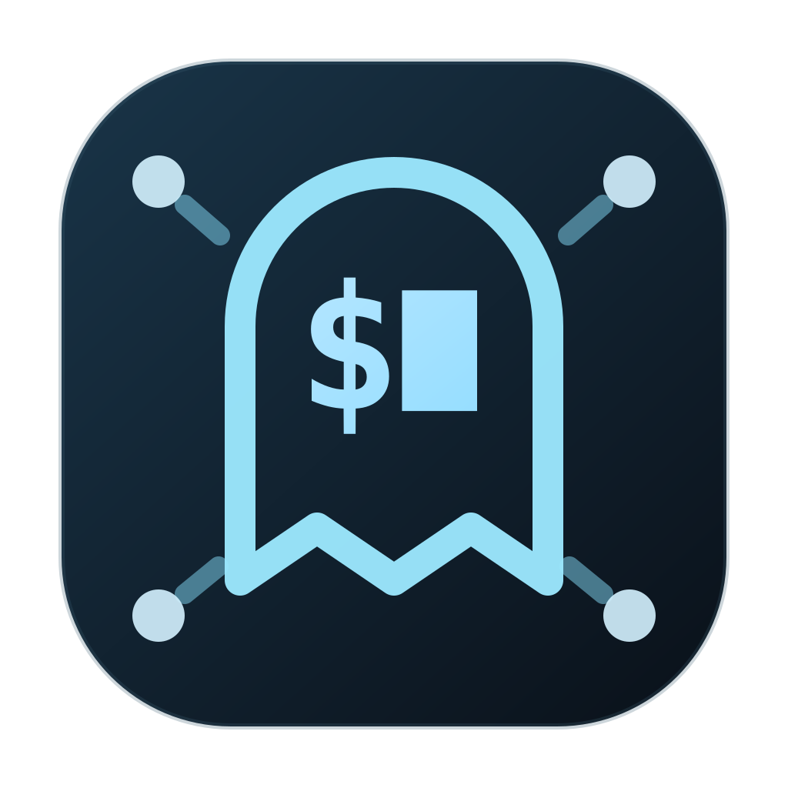
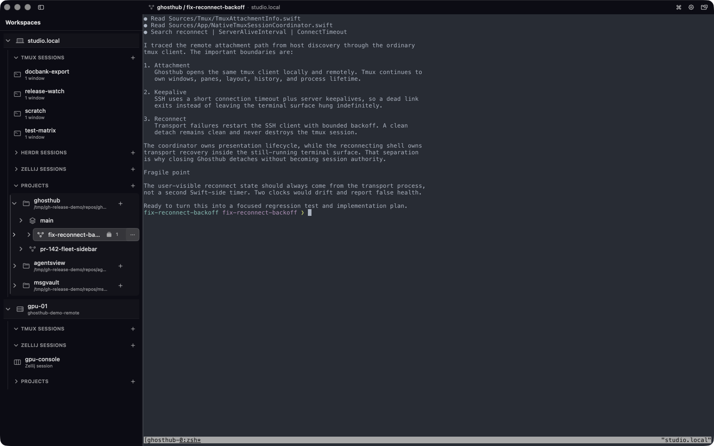

<p align="center">
  <a href="https://ghosthub.ai">
    
  </a>
</p>

<h1 align="center">Ghosthub</h1>

<p align="center">
  <strong>Manage local and remote tmux, Herdr, and Zellij without touching a local shell.</strong>
  <br>
  Browse hosts, attach to sessions, reconnect over SSH, and spin up Git worktrees from one native Mac app.
</p>

<p align="center">
  
  
  <a href="LICENSE">
    
  </a>
</p>

<p align="center">
  <a href="https://ghosthub.ai"><strong>Website</strong></a>
  ·
  <a href="https://github.com/kenn-io/ghosthub/releases"><strong>Download</strong></a>
  ·
  <a href="https://ghosthub.ai/overview/"><strong>Overview</strong></a>
  ·
  <a href="https://ghosthub.ai/docs/"><strong>Docs</strong></a>
  ·
  <a href="https://ghosthub.ai/docs/changelog/"><strong>Changelog</strong></a>
  ·
  <a href="https://discord.gg/nEB7VaAnU9"><strong>Discord</strong></a>
</p>

<p align="center">
  
</p>

Ghosthub is a dedicated Mac app for managing local and remote tmux, Herdr, and
Zellij sessions. It replaces the workflow of juggling multiplexer sessions in a
general-purpose terminal like iTerm2, Ghostty, or Kitty: opening a local shell,
running `ssh`, listing sessions, and reattaching by hand whenever a connection
drops. In Ghosthub, you pick a host and session in the sidebar and land straight
inside it without ever touching a local shell.

Keep your usual terminal emulator for quick local commands. Ghosthub focuses on
multiplexer sessions across your Mac and SSH hosts, rendering each attached view
with libghostty 1.4.0 while leaving tmux, Herdr, and Zellij in charge of their
own panes, scrollback, key bindings, and running programs. If you want a
separate Git checkout for each task, you can register a repository and use
[kwt](https://kwt.sh) to create branch or pull-request worktrees with their own
tmux sessions. Git and worktrees are optional.

Ghosthub is alpha software. File bug reports and feature requests in
[GitHub issues](https://github.com/kenn-io/ghosthub/issues).

## What it does

- Manage tmux, Herdr, and Zellij sessions across your Mac and SSH hosts without
  opening a local shell.
- Open local and remote sessions side by side in native Mac windows and tabs,
  and reconnect automatically after ordinary SSH drops.
- Preview tmux sessions in the sidebar and see which ones have new output
  without switching windows.
- Create Git worktrees from branches or pull requests, check changed files from
  the sidebar, and flag work to come back to.
- Rename standalone tmux sessions without stopping the programs inside them.
- Jump straight to any session, host, project, or action with **Command-Shift-P**.
- Render attached sessions with libghostty 1.4.0, configured in Ghosthub's own
  `ghostty.conf` separate from Ghostty.app.

Take the [visual overview](https://ghosthub.ai/overview/) for a quick tour, or
read the [public guides](https://ghosthub.ai/docs/) for setup, controls, and
limits.

## Install and open a session

You need an Apple Silicon Mac running macOS 15 (Sequoia) or newer. Install
Ghosthub with Homebrew:

```sh
brew install kenn-io/tap/ghosthub
```

Or download the [latest stable DMG](https://github.com/kenn-io/ghosthub/releases/latest)
and drag **Ghosthub** into **Applications**.

Install at least one supported multiplexer on the host where you work: tmux
3.2+, Herdr 0.8.0+, or Zellij 0.44+. To install tmux on your Mac:

```sh
brew install tmux
```

1. Open **Ghosthub** from **Applications**.
2. Expand your Mac in the sidebar.
3. Click an existing session to open it, or click **+** beside your Mac to
   start a new one.

Closing a window or tab only detaches. Your programs keep running in the
multiplexer until you choose **Kill Session…** or **Stop Session…** and
confirm. See [Sessions](https://ghosthub.ai/docs/sessions/).

This README and the website docs track `main`. Anything newer than the latest
stable release appears under
[Unreleased](website/docs/content/changelog.md#unreleased) in the changelog.
Read about
[stable and nightly builds](https://ghosthub.ai/docs/getting-started/#release-and-nightly-builds)
before switching channels.

On macOS, Ghosthub also opens
[Herdr desktop terminals and tabs](https://ghosthub.ai/docs/sessions/#herdr-desktop-terminals).
You see [Herdr's split layout](https://ghosthub.ai/docs/sessions/#herdr-desktop-splits)
as read-only panes, while Herdr desktop keeps control of splits and sizing.
Ghosthub also opens [Rex windows](https://ghosthub.ai/docs/sessions/#rex-windows)
and their split panes on your Mac and on SSH hosts. The Linux client opens
[remote Rex windows](https://ghosthub.ai/docs/sessions/#linux-remote-rex-windows)
over SSH, including over Tailscale.

## Work with your agents

Start a session from Ghosthub, a shell, or a coding agent, then open it from
the sidebar. Because sessions live in tmux, Herdr, or Zellij, you and your
tools share the same running session from either the CLI or Ghosthub, and
closing Ghosthub leaves everything running.

For Git projects, agents can manage worktrees with [kwt](https://kwt.sh) and
read its JSON output. See
[Sessions started by tools and agents](https://ghosthub.ai/docs/sessions/#sessions-started-by-tools-and-agents)
for how discovery and tmux sockets work.

Point your agent at [`llms.txt`](https://ghosthub.ai/llms.txt) to find the user
guides. Every guide has a Markdown copy built from the same source as the web
page, such as [sessions.md](https://ghosthub.ai/docs/sessions.md).

## Guides

| If you want to… | Read |
| --- | --- |
| Connect another machine or reorder hosts | [Remote hosts](https://ghosthub.ai/docs/remote-hosts/) |
| Create worktrees or find a moved project | [Projects and worktrees](https://ghosthub.ai/docs/projects-worktrees/) |
| Save a command for a new tmux session | [Launch profiles](https://ghosthub.ai/docs/launch-profiles/) |
| Use windows, tabs, and the Command Palette | [Windows and navigation](https://ghosthub.ai/docs/windows-navigation/) |
| Change fonts, colors, themes, or clipboard settings | [Terminal configuration](https://ghosthub.ai/docs/terminal-configuration/) |
| Find or change a shortcut | [Keyboard shortcuts](https://ghosthub.ai/docs/keyboard-shortcuts/) |
| Review or turn off anonymous usage reporting | [Privacy](https://ghosthub.ai/docs/privacy/) |
| Fix a connection or session problem | [Troubleshooting](https://ghosthub.ai/docs/troubleshooting/) |

Ghosthub reads your OpenSSH config and prompts for host-key checks or logins
when needed. Remote macOS and Linux hosts work with tmux, Herdr, and Zellij.
Connecting from macOS to native Windows hosts running psmux is experimental;
see [experimental Windows hosts](https://ghosthub.ai/docs/remote-hosts/#experimental-windows-hosts)
for requirements and limits.

## Development and contributions

Ghosthub does not accept unsolicited pull requests. File bug reports and
feature requests in [GitHub issues](https://github.com/kenn-io/ghosthub/issues).
If you want to contribute code, read [CONTRIBUTING.md](CONTRIBUTING.md) and
contact Kenn Software before starting work. Contributions use the Apache
License 2.0, with no contributor license agreement.

Build instructions, architecture notes, security boundaries, and release steps
live in [`docs/`](docs/README.md).

## License

Copyright 2026 Kenn Software LLC.

Ghosthub is free and open source software licensed under the
[Apache License 2.0](LICENSE). Third-party components keep their own licenses;
see [the notices](LICENSES/THIRD-PARTY-NOTICES.md).
