# Windows and Linux Rust Port

This document is the maintained design for the native Rust Ghosthub apps on
Windows and Linux. The goal is to bring the same native hub for local and
remote terminal multiplexers to Windows and Linux. The Rust port does not
replace the macOS SwiftUI/AppKit app, does not embed a shared Rust runtime into
Swift, and does not change macOS away from SwiftUI. Shared product and terminal
rules live in [architecture.md](architecture.md) and
[terminal-sessions.md](terminal-sessions.md).

### Current capabilities

- **Windows (WSL2):** discovers, attaches to, creates, and confirms kills of
  tmux sessions in a WSL2 distro, discovers optional Herdr and Zellij sessions
  there, and connects to remote SSH hosts through the selected WSL2 distro's
  OpenSSH configuration.
- **Native Linux (local):** discovers, attaches to, creates, and confirms kills
  of local tmux sessions; registers KWT projects, imports branches and GitHub
  pull requests, opens worktrees, and removes worktrees with confirmation;
  supports local Herdr (running and stopped inventory, create, attach, restart,
  and confirmed stop/delete) and local Zellij (active discovery, create,
  attach, and confirmed kill).
- **Connected SSH hosts:** supports tmux (create, attach, and confirmed kill
  bound to live session identity), Herdr (create, attach, restart, and
  confirmed stop/delete), Zellij (create, attach, and confirmed active kill),
  KWT projects/worktrees/PR imports, and remote Rex windows on Linux.
- **Herdr scope:** Herdr support in the Rust port currently covers the older
  Herdr TUI. The macOS app's `herdr-core` desktop-terminal integration remains
  separate parity work.

### Download a preview

Kenn-dist publishes Rust preview archives for Linux and Windows on x86-64 and
ARM64. The
[unstable download index](https://dl.kenn.sh/channels/unstable/install-index-v1)
points to a manifest listing each archive's URL, SHA-256, and source revision.
Preview builds follow a reviewed source pin, so a merge to `main` may appear in
source builds before the preview pin updates.

Extract the archive and run `ghosthub` on Linux or `ghosthub.exe` on Windows.
Keep the Windows DLLs beside `ghosthub.exe`. On Debian and Ubuntu, install
`libxkbcommon-x11-0` if the loader reports that `libxkbcommon-x11.so.0` is
missing. On Windows, connections to remote SSH hosts still use the selected
WSL2 distro's OpenSSH configuration.

## 1. Product and Dependency Boundary

### Platform split

- **macOS:** stays SwiftUI/AppKit with libghostty.
- **Windows:** uses Rust and GPUI. Its first local slice attaches to real tmux
  inside a WSL2 distro through `wsl.exe` and ConPTY.
- **Linux:** enables both X11 and Wayland in the native Rust/GPUI shell, uses a
  native PTY for local tmux clients, and embeds the pinned KWT helper. X11
  development checks do not establish Wayland or hardware-GPU acceptance.
- **Shared model:** every platform keeps the Host, Project, Worktree, and
  ordinary multiplexer-session mental model.
- **Discovery authority:** KWT owns project and worktree identity plus exact
  session names. Direct multiplexer queries supply standalone sessions.
- **Session ownership:** tmux owns server-side windows, panes, layout, history,
  alternate-screen state, processes, and lifetime. The rejected psmux 3.3.7
  probe remains regression evidence rather than a supported backend.
- **Ghosthub ownership:** Ghosthub owns discovery, presentation, ordinary
  client attachment, transport reconnect, and confirmed destruction.
- **No shared runtime or DB:** the Swift and Rust apps share behavioral
  contracts and fixtures rather than a language boundary or live database.

The Rust workspace lives under `rust/`. Rust-port work never modifies Swift
sources, Swift tests, `Package.swift`, or macOS workflows. The repository-root
`contracts/` directory is a Rust-owned compatibility corpus; its manifest and
first path-resolution fixtures run on both Windows and Linux. Any future Swift
consumer is a separate project, not a requirement of Rust feature work.

### License closure

Every linked Rust dependency must pass the repository's Apache-2.0-compatible
license policy. MIT and Apache-2.0 crates are allowed. GPL and AGPL crates from
Zed (including its UI and terminal application layers) are forbidden.

`rust/deny.toml` holds the reviewed allowlist. `cargo-deny` checks normal,
build, development, target-specific, and transitive GPUI dependencies. A crate
cannot enter `Cargo.lock` just because its direct license looks fine; its full
transitive closure must pass.

GPUI 0.2.2's Windows/Linux dependency graph currently requires two exact
MPL-2.0 exceptions: `dwrote` 0.11.5 and `option-ext` 0.2.0. MPL-2.0 is
compatible with Apache-2.0, and scoping the exception by crate and version
prevents new copyleft crates from entering unnoticed. Known unmaintained
transitives are listed individually in `rust/deny.toml` and must be re-reviewed
whenever the GPUI pin changes. GPL and AGPL third-party crates remain
unconditionally rejected. Ghosthub's own Rust packages use Apache-2.0 and pass
the same allowlist.

### Verified dependency findings

**Terminal engine (`libghostty-vt` 1.0):** Ghosthub uses `libghostty-vt` 1.0 as
its single terminal engine for terminal state, resize/reflow, render snapshots,
and mode-aware keyboard encoding. `Vendor/libghostty-vt.version.json` pins the
source archive, dependency archive checksums, and Zig version independently of
the macOS app's libghostty pin. Both archives are checksum-verified before
extraction and compiled offline using bundled dependencies.

- `terminal::vt` owns all C handles on a single terminal worker. A small C
  bridge compiles against public headers, and Rust copies cells and effects
  before publishing them through `SurfaceStore`. No C pointer ever reaches GPUI
  or another thread.
- GPUI owns drawing and fonts, while `portable-pty` owns Linux PTYs and Windows
  ConPTY. Kitty graphics stay disabled until the renderer can draw them.
  Multiplexers still own session history and layout.
- Linux links the static library. Windows builds a GNU-ABI DLL (`ghostty-vt.dll`)
  and links it via its import library from the MSVC Rust binary. Cargo copies
  `ghostty-vt.dll` beside the app and test binaries; keep it next to
  `ghosthub.exe` in Windows CI artifacts and installs.
- Windows x86_64 CI runs the engine contracts and real ConPTY tests without
  WSL. Windows ARM64 can build the library but still needs separate runtime
  acceptance. Removing WSL from Windows SSH leases remains separate host work.

**Pinned KWT (`KWT_REVISION`):** repository-root `KWT_REVISION` is the sole
source of the audited KWT revision. That revision reads `KWT_HOME` or defaults
to `$HOME/.config/kwt`. It does not read Ghosthub `init.toml`, `config_home`,
or `XDG_CONFIG_HOME`. Rust must not copy the unsupported `init.toml` scanner;
the two legacy Swift copies are outside Rust-port scope.

### Executable bootstrap

The checked-in workspace pins Rust 1.96.1 and GPUI 0.2.2 across
`ghosthub-model`, `ghosthub-ui`, and the `ghosthub-app` entry point (`ghosthub`
binary). The GPUI window has been built and launched natively on Windows ARM64.
Linux enables Wayland and X11 and is compiled and tested directly rather than
inferred from Windows builds.

Rust CI lives in `.github/workflows/rust-port.yml`. It runs Windows and Linux
jobs on pushes and PRs targeting `main` whenever Rust files, the shared
`Makefile`, or `KWT_REVISION` change. Swift macOS CI remains separate.

### Build and inspect the Linux application

Use the toolchain pinned in `rust/rust-toolchain.toml`, and install the pinned
Zig toolchain with `mise install` before building. On Debian or Ubuntu, install
the GPUI build dependencies listed in `.github/workflows/rust-port.yml`, plus a
Vulkan driver and system fallback fonts.

The Linux executable bundles **Inter** for UI controls and **JetBrains Mono**
as the default terminal font. Both load before GPUI measures text so minimal or
headless desktops never fall back to a proportional font in the terminal grid.
Explicit user font settings still take precedence; select JetBrains Mono under
**Settings → Appearance** to switch an existing config. Windows keeps its
native UI font and **Cascadia Mono** terminal default.

#### Headless setup and core checks

On a headless Linux host, install Mesa's software Vulkan driver and DejaVu
fallback fonts, then build and run the core checks:

```sh
sudo apt-get install --no-install-recommends \
  build-essential clang cmake libfontconfig-dev libvulkan1 \
  libwayland-dev libx11-xcb-dev libxkbcommon-x11-dev lld llvm pkg-config \
  mesa-vulkan-drivers fonts-dejavu-core xvfb xauth xdotool ffmpeg tmux bubblewrap
make rust-build
make rust-check
xvfb-run -a make rust-test-fonts-live
make rust-test-kwt-live
```

- **libghostty-vt:** the `make` targets build `libghostty-vt` automatically.
  Before running Cargo directly, run `make bootstrap-libghostty-vt`. To
  cross-build the Windows DLL and import library from Linux (compile proof
  only, not Windows runtime acceptance), run:

  ```sh
  make bootstrap-libghostty-vt RUST_TARGET=x86_64-pc-windows-msvc
  ```

  CI runs `uv run tools/build_libghostty_vt.py --install-zig` to stage the
  checksum-pinned Zig compiler under `.build` without modifying the host
  toolchain.
- **Bundled KWT helper:** install Go before building. On Linux,
  `make rust-build` compiles `KWT_REVISION` and embeds it in the app. Pass
  `KWT_BINARY_PATH=/absolute/path/to/kwt` to reuse a prebuilt binary;
  `GHOSTHUB_KWT_BUNDLE` takes precedence over `KWT_BINARY_PATH`. The same
  bundled Linux helper drives SSH leases, so no separate KWT or Windows binary
  is needed for Linux SSH hosts.

#### Running and capturing locally

The built binary is `rust/target/debug/ghosthub`. Always isolate development
runs with disposable roots so configured hosts, helpers, and preferences stay
separate from installed app state:

```sh
capture_root=$(mktemp -d)
export GHOSTHUB_HOME="$capture_root/home"
export GHOSTHUB_CONFIG_HOME="$capture_root/config"
export GHOSTHUB_STATE_HOME="$capture_root/state"
./rust/target/debug/ghosthub
```

For headless screenshots, launch under `xvfb-run -a -s '-screen 0 1280x800x24'`,
use `xdotool` to wait for, position, and focus the window, and capture with
FFmpeg. Always inspect the image because a created X11 window does not prove
GPUI painted it. Keep the bundled defaults instead of installing capture-only
fonts. `make rust-test-fonts-live` verifies regular and bold Latin, Greek, and
Cyrillic glyph widths at the default size to catch proportional fallback. Font
sources and update instructions live in
[the font inventory](https://github.com/kenn-io/ghosthub/blob/main/rust/ui/fonts/README.md).
Stop the app and virtual display afterward, keep development captures local,
and follow the
[publishing workflow](https://github.com/kenn-io/ghosthub/blob/main/website/README.md)
for website screenshots. Software-rendered X11 captures do not prove Wayland,
hardware GPU, Windows WSL, or ConPTY acceptance.

With empty config, Linux publishes a **Local** host and queries the default
tmux server after the first frame. A missing tmux binary leaves the app shell
usable with a host diagnostic. Local Linux settings are separate from Windows
`[wsl]` settings:

```toml
[local]
tmux-binary = "/usr/bin/tmux"
# Optional absolute directory passed as TMUX_TMPDIR:
# socket-directory = "/tmp/ghosthub-demo-tmux"
```

For development captures, point `local.socket-directory` at a private temporary
directory with synthetic sessions only. Redirecting Ghosthub state roots alone
does not isolate tmux or KWT: set `KWT_HOME` to a disposable directory and use
a private `/tmp` mount (for example with Bubblewrap), because KWT owns its
named sockets and ignores `TMUX_TMPDIR` for them. Attaching to an existing
server preserves its config; test fixtures start private servers with
`-f /dev/null` and a controlled shell.

#### Live Linux acceptance suites

- **Local tmux (`make rust-check`):** requires `/usr/bin/tmux`. Exercises
  discovery, output, input, resize, creation, detach/close survival, and
  confirmed kills that reject same-name replacements.
- **Local KWT (`make rust-test-kwt-live`, `make rust-test-kwt-pr-live`):**
  requires Bubblewrap and runs in private `/tmp`, PID namespace, home, Git
  config, and KWT state (staging the app and helper inside the fixture so
  checkouts under `/tmp` work). Both targets accept relative `KWT_BINARY_PATH`
  paths from the repo root. `make rust-test-kwt-live` covers project
  registration, branch create/import, shell input, generation checks, confirmed
  removal, and unregistering without deleting checkouts or sessions.
  `make rust-test-kwt-pr-live` also tests GitHub PR import, idempotent reuse,
  protected attach/recreation, and removal; it needs `KWT_GITHUB_TOKEN` and
  network access to the public contract repository.

  On Ubuntu 24.04, install `apparmor-profiles` and load the Bubblewrap profile
  first (Rust CI does this before building):

  ```sh
  sudo apparmor_parser -r /usr/share/apparmor/extra-profiles/bwrap-userns-restrict
  ```

- **Local Herdr (`make rust-test-herdr-live`):** supply an existing Linux
  binary:

  ```sh
  make rust-test-herdr-live HERDR_BINARY_PATH=/absolute/path/to/herdr
  ```

  Runs in private process and network namespaces with disposable home, XDG
  config, state, and runtime directories. Covers shell input, detach/close
  survival, restart, confirmed stop/delete, stale confirmation rejection, and
  silent disappearance when Herdr is removed. CI downloads and verifies Herdr
  0.9.5 for this test; Ghosthub never installs or updates Herdr for users.

- **Local Zellij (`make bootstrap-zellij-test && make rust-test-zellij-live`):**
  runs in private process/network namespaces with a private `/tmp` and
  disposable home and XDG directories. Covers shell input, resize, detach/close
  survival, cancelled kills, confirmed kills across two scenes, exclusion of
  exited sessions, exact selection among multiple sessions, names with spaces
  and quotes, rejected names, and continued tmux use if Zellij disappears.

  CI builds the upstream revision in `ZELLIJ_TEST_REVISION` (in the Makefile)
  with locked dependencies into `.build/zellij-test` for both local and SSH
  tests. That revision includes
  [Zellij's startup-probe fix](https://github.com/zellij-org/zellij/pull/5630)
  because Zellij 0.45.1 can panic if inventory connects before its first client
  initializes. This helper is test-only; Ghosthub never installs or updates
  Zellij for users. To update it, edit `ZELLIJ_TEST_REVISION`, rebuild, and run
  `make rust-test-zellij-live` and `make rust-test-ssh-live`. Pass
  `ZELLIJ_BINARY_PATH=/absolute/path/to/zellij` to test another install.

  Because Zellij 0.45.1 treats `--` as starting an initial command rather than
  ending option parsing, Ghosthub passes session names directly to
  `zellij attach` and rejects creation or attachment for names starting with
  `-` (except `-` itself) and the reserved names `help` and `options`. Existing
  sessions with those names still appear and can be killed with confirmation.
  This rule applies across native Linux, WSL, and SSH; names with spaces or
  quotes remain exact arguments.

- **Native Linux SSH (`make rust-test-ssh-live`, `make rust-test-ssh-pr-live`):**
  install `openssh-server`, `openssh-client`, `tmux`, and `bubblewrap`, then
  run:

  ```sh
  make rust-test-ssh-live HERDR_BINARY_PATH=/absolute/path/to/herdr \
      ZELLIJ_BINARY_PATH=/absolute/path/to/zellij
  ```

  This suite runs the real `ghosthub-app` entry point and bundled controller
  against a disposable OpenSSH server in private process and network namespaces
  with generated keys and isolated home/KWT roots. CI runs it on Linux. It
  verifies:
  - Host-key prompts, inventory, exact selection, input, resize, retained
    switching, detach, app close, and reopening with the accepted key.
  - Separate daemon ownership: an existing account KWT daemon keeps serving
    local projects while SSH leases belong to Ghosthub's daemon, and
    reconnecting after the account daemon stops leaves it stopped.
  - Auth recovery: a rejected public key keeps the app shell usable, shows the
    SSH diagnostic and exit status on that host, and recovers once authorized.
    KWT's optional failure `details` object is accepted without relaxing stream
    ordering or route/prompt validation.
  - Remote tmux creation: exact quoted names, duplicate rejection, input,
    detach/close survival, UTF-8 locale and non-ASCII input on first-session
    creation with no prior server, and confirmed kills (cancel, fresh identity,
    same-name replacement, server restart with reused session ID, changed
    connection, and two-scene cleanup).
  - Remote Herdr: confirmed stop/delete, cancelled and stale confirmations,
    cross-window cleanup, and recovery after a failed Stop (restoring a client
    only when fresh inventory confirms the session is still running and the
    user has not navigated away).
  - Remote Zellij: cancelled and stale kills, cross-window cleanup, queued
    attachment cancellation, and recovery after failed kills or reconnects,
    using isolated Zellij config and runtime roots.

  `make rust-test-ssh-pr-live` additionally needs `KWT_GITHUB_TOKEN` (staged
  only in the fixture remote account) and outbound HTTPS to GitHub over a fresh
  loopback SSH port. It lists and imports a public fixture PR over SSH, checks
  remote auth failures and stale-registration guards, and opens the result via
  protected attachment. Windows/WSL controllers and remote macOS servers need
  separate acceptance.

#### Tracking work

Track implementation and baseline failures in Kata. Run
`kata federation status --agent` before resuming across machines and keep the
local spoke binding when federation is healthy. Work in order: gather build and
rendering evidence, fix reproduced baseline failures, then advance the native
Linux local-session, remote/worktree, Settings, persistence, and platform
issues. Never treat an old issue comment or a passing compile check as proof of
completion.

## 2. Terminal Presentation and Session Execution

### Launch authority is structural

The Rust type system separates three launch authorities:

- **`AttachPlan`:** cloneable; launches one exact ordinary-client attachment.
- **`CreateOnce`:** neither cloneable nor serializable; launch consumes it and
  returns the presentation plus an `AttachPlan`.
- **`RepairOrOpen`:** cloneable and intentionally re-runnable; distinct
  variants represent ordinary KWT probe-before-open and protected pull-request
  repair/attach.

| Path | Initial authority | Later SSH reconnect |
| --- | --- | --- |
| Discovered unbound session | `AttachPlan` | Exact attach |
| Explicit local bare creation | `CreateOnce` with atomic `new-session -A` | None |
| Explicit remote bare creation | One-shot `CreateOnce` probe/create | `AttachPlan` |
| Ordinary KWT workspace | `RepairOrOpen` workspace variant | Exact probe, attach if present, rerun `kwt open` only if absent |
| Protected pull-request workspace | `RepairOrOpen` protected variant | Rerun exact `kwt pr attach` |

No mutable creation flag exists, and recovery cannot accept `CreateOnce`. The
table describes the full contract; automatic recovery currently covers active
ordinary SSH tmux clients, while KWT repair during reconnect remains separate
work.

Local client exit always ends the presentation (Windows WSL does not reconnect
a local `wsl.exe` relay after exit). When a selected remote tmux client exits
with OpenSSH status `255`, automatic host reconnect can restore that exact
session; any other exit status ends the presentation. Recovery relies on the
selected session identity rather than alternate-screen output and survives SSH
failures before the terminal starts.

### Shared local host boundary

`LocalHost` owns the Linux session layer shared by native Linux and WSL2. Its
endpoint distinguishes the native machine from a named WSL distro, so admission
caches never cross endpoints even when runtime evidence matches.
`LinuxRuntimeIdentity` records the kernel boot ID and PID 1 start time; Windows
also requires a WSL2 kernel before admission.

Native Linux runs exact POSIX argv through `/usr/bin/env`. WSL prepends the
pinned distro and `--exec` to the system-owned `wsl.exe` launcher. Both share
tmux capability admission, exact session identity checks, one-shot creation
receipts, and confirmed destruction. Workspace and scene state track the local
host identity rather than assuming WSL. Neither path reconstructs server panes
or kills the server when a presentation closes.

Native Linux exposes tmux, KWT projects/worktrees, and optional Herdr and
Zellij sessions. Herdr reuses WSL's login-environment executable probe and
whole-session lifecycle; a missing install hides the Herdr group silently.
Because Herdr has no stable generation ID, lifecycle checks compare runtime,
executable, session state, default role, and config paths (so an otherwise
identical replacement cannot be distinguished). Zellij uses the shared
active-only discovery and confirmed-kill flow.

### Native Linux Herdr sessions

Expand **Local → Herdr Sessions** and select **+** to create a session, or
select a running session to attach. A running row's menu offers **Detach** and
confirmed **Stop**; a stopped row offers **Restart** and confirmed **Delete**.
Closing the view or app detaches only; **Stop** ends the session's processes
while keeping its saved layout.


### Native Linux Zellij sessions

Install Zellij 0.45.1 in your login environment and refresh **Local**. Choose
**+** beside **Zellij Sessions**, enter a name, and select **Create**. Names
starting with `-` (except `-` itself), `help`, and `options` cannot be created
or attached because Zellij parses them as flags or subcommands. Select an
active session to attach; its row menu offers **Detach** and confirmed **Kill
Session**. Detach and app close leave the server running, while **Kill
Session** ends its processes and closes matching Ghosthub views. Ghosthub lists
active sessions only and never resurrects or deletes exited sessions.


### Native Linux SSH sessions

Native Linux SSH route resolution and leases use `ssh/kwt` under the resolved
application state root as `KWT_HOME`, while local project and worktree commands
continue using the user account's KWT home. See the
[SSH controller boundary](architecture.md#external-state) for daemon ownership.

#### Connecting and automatic reconnect

1. Build with `make rust-build` and open **Settings → Hosts**.
2. Add a host name and an SSH destination from your OpenSSH config, then click
   **Save Host**.
3. Click **Connect** beside the host in the sidebar and review any host-key or
   authentication prompt.
4. Select a discovered session to open it; switching tmux rows retains the
   previous client.


When an active ordinary tmux terminal loses its SSH connection (on the default
server or KWT's shared server), Ghosthub retries automatically after 1, 2, 4,
8, 16, and then 30 seconds, with a 15-second limit per attempt. **Refresh** or
**Retry** runs immediately and resets backoff.

- After reconnect, Ghosthub reopens the same session on the same server, even
  if it was renamed. It never creates a missing session or opens a replacement
  that reused the name.
- Selecting another session, detaching, closing the window, or removing the
  host cancels recovery. Failed connects or terminal startups preserve recovery
  for a later retry, and a reconnect finishing before the old terminal reports
  its exit still restores the session.
- Auth failures, changed SSH settings, and host-key prompts pause automatic
  retries until you choose **Retry**. **Cancel** stops an in-progress attempt
  and further automatic retries.
- Retained inactive clients, protected PR worktrees, Herdr, and Zellij require
  re-selecting the session after transport loss. Windows uses the same policy
  over its WSL SSH host boundary; live recovery tests currently run on Linux.

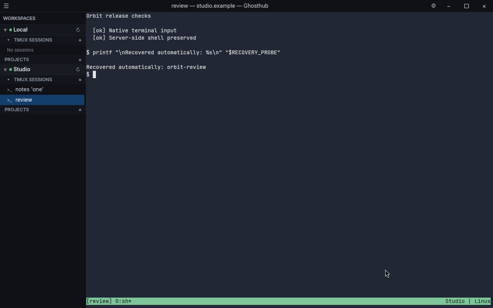

#### Remote tmux, Herdr, and Zellij lifecycle

- **Create tmux:** click **+** beside **Tmux Sessions** on a connected host,
  enter a name, and click **Create**. Existing names on that host are rejected.
  If tmux discovery failed, fix the host's tmux path or connection first.
  **Detach** or closing Ghosthub closes only clients; reopening Ghosthub leaves
  SSH hosts disconnected until you click **Connect**.

  

  

- **Kill tmux:** open a session's **…** menu, choose **Kill**, and confirm the
  name and host. Ghosthub fetches a fresh tmux identity before showing the
  dialog and kills only that exact identity; a replaced session or changed SSH
  connection requires a new confirmation. Success closes matching clients in
  every window and refreshes inventory without touching other sessions.

  

- **Remote Herdr:** click **+** beside **Herdr Sessions** to create a session,
  or select a running row to attach. Running rows offer confirmed **Stop**
  (ending processes while keeping the saved layout); stopped rows offer
  **Restart** and confirmed **Delete** (the default session cannot be deleted).
  Ghosthub rechecks state, executable, and saved paths over the same SSH
  connection before Stop or Delete; a changed connection requires a new
  confirmation. Like local hosts, Herdr lacks a generation ID to distinguish
  otherwise identical replacements.

  Stop detaches matching clients across windows first. If Stop fails, Ghosthub
  refreshes inventory and restores clients only if the same session is still
  running and the user has not navigated away. An unreadable result leaves
  clients detached with a Herdr diagnostic; reconnect to refresh inventory
  while other backends stay usable.

  

  

- **Remote Zellij:** open an active row's **…** menu, choose **Kill**, and
  confirm. Ghosthub verifies fresh active inventory and executable identity on
  the confirmed SSH connection. Success closes matching clients across windows
  and removes the row; cancellation leaves it running. If kill fails, clients
  restore only when fresh inventory confirms the session is still active and
  navigation has not changed. Zellij has no generation ID, so an identical
  same-name replacement cannot be detected. Exited sessions stay hidden, and
  queued opens cannot resurrect a killed session.

  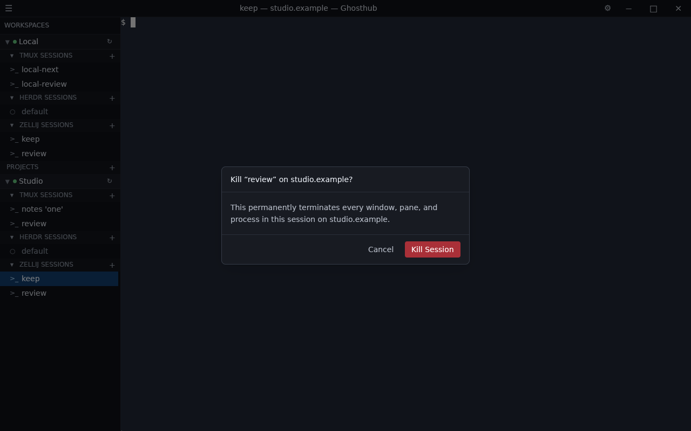

#### Remote projects, worktrees, and directories

Ghosthub automatically installs or repairs its pinned KWT helper on connected
macOS and Linux SSH hosts. Terminal discovery stays usable while projects load
or if helper setup fails.

- **Add or remove a project:** click **+** beside **Projects**, enter the
  repository's absolute remote path (there is no local folder picker for remote
  hosts), and click **Add Project**. Use **×** beside a project to unregister
  it after confirmation; unregistration keeps the checkout, worktrees, and
  sessions intact, and a changed registration requires a new confirmation.
  Registrations persist in KWT on the remote host across restarts.

  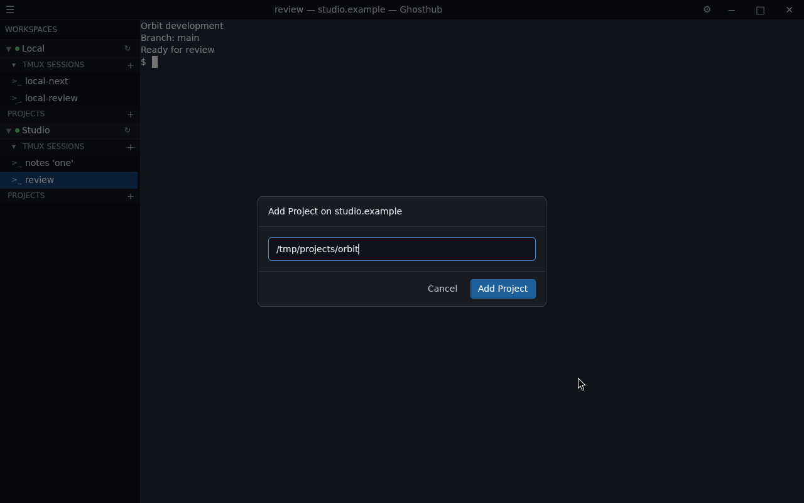

- **Create a branch worktree:** click **+** beside a remote project to create a
  worktree from a new or existing branch. The searchable branch list keeps
  KWT's exact source reference when multiple remotes share a branch name.
  **Create** runs the pinned helper's guarded non-launching operation,
  refreshes inventory, and opens the new worktree (unless the user navigated
  away first). Successful branch creation and PR imports reserve the follow-up
  attachment before releasing the KWT mutation so automatic reconnect in
  another window waits for both; discarding the event, navigating away, or
  closing the scene releases that reservation.

  Branch listing and creation share the host's KWT operation reservation.
  Cancelling releases listings immediately, and closing the owning scene
  cancels queued creation. Both Ghosthub and KWT recheck the repository and
  registration before creating the checkout. Creation is never retried
  automatically; after a timeout, Ghosthub inspects fresh inventory for a new
  worktree identity and asks the user to refresh if the result is uncertain.

  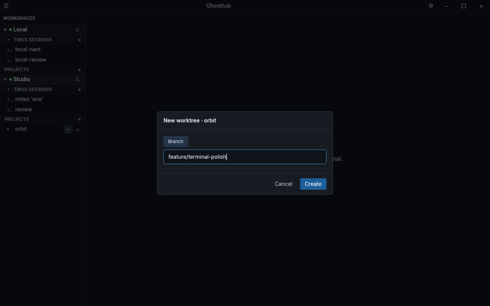

- **Open worktrees and directory workspaces:** clicking an ordinary remote
  worktree (even with no running session) invokes the pinned helper with the
  captured repository, registration, generation, and exact session name. The
  SSH client records its PID and Ghosthub verifies its tmux identity before
  publishing. Close, detach, and newer navigation cancel queued opens, and
  retained clients are reused. Idle registered directories (added remotely via
  `kwt workspace add /absolute/path`) open through the same path, while running
  directories attach directly; a removed registration requires refresh rather
  than opening an arbitrary stale path.

  Both default and KWT's standard `kwt` tmux servers are supported for attach,
  retained switching, detach, and confirmed Kill. Discovery and confirmation
  query the selected server independently, and the `kwt` server ignores
  `TMUX_TMPDIR` just as KWT does. KWT keeps new sessions alive during setup
  when tmux's `destroy-unattached` option is enabled, then restores the
  captured policy on attach. Reopening a killed default-server worktree
  publishes its new KWT-server socket before presenting the client so future
  clicks reuse it.

  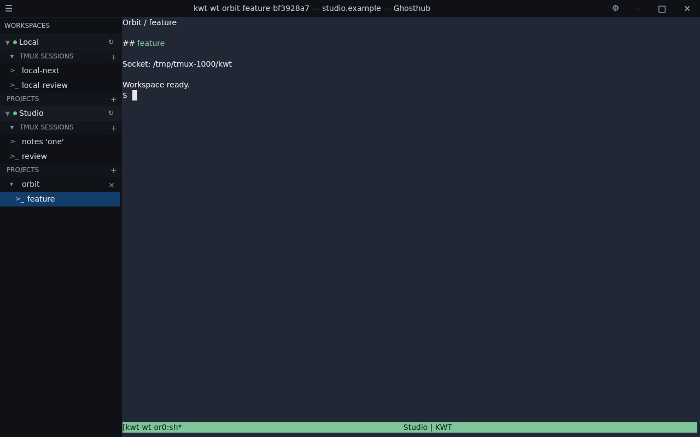

  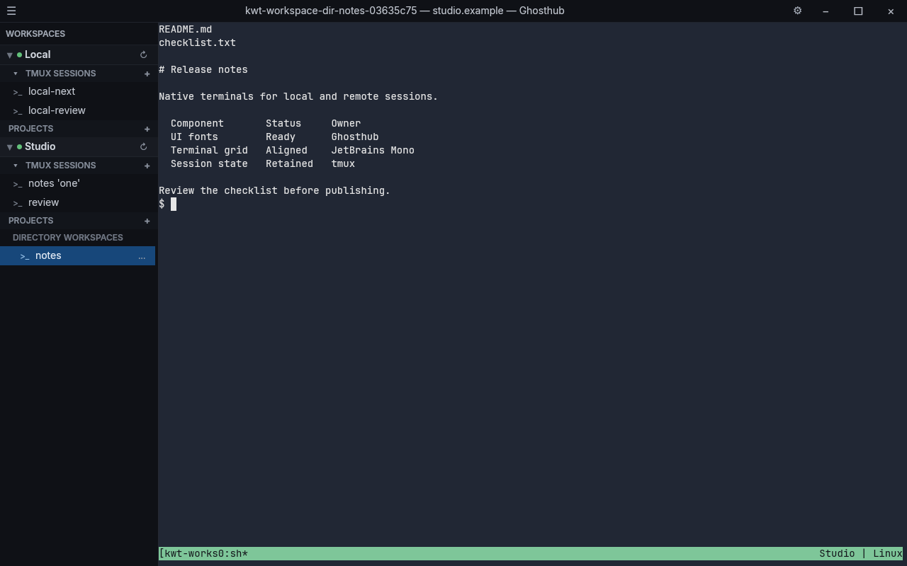

- **Import and open pull-request worktrees:** select **Pull Request** in the
  same dialog to list open PRs, pick one, or enter its number or URL. The
  remote KWT helper uses that remote account's `KWT_GITHUB_TOKEN` or
  `gh auth login`; Ghosthub never forwards local GitHub credentials. Provider
  reads and imports get a five-minute deadline while ordinary inventory keeps
  its short deadline. Closing the dialog cancels listings; closing the scene
  cancels an in-flight import. Reconnect fences import results and refreshes
  inventory after settlement, and uncertain imports refresh without replaying
  the mutation. Only results matching fresh registration, generation, session,
  and protected socket open automatically (and newer navigation still wins).

  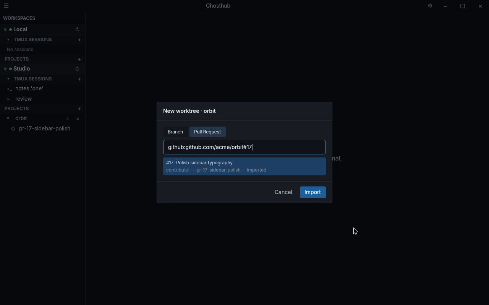

  Imported PR worktrees open through `kwt pr attach` with the captured
  repository, registration, path, generation, session, and protected socket.
  Fresh inventory and the attached client's session identity must match before
  publication. KWT owns provenance checks, inert shell layout, and credential
  filtering; protected named servers use the standard tmux socket directory.

  Protected rows support open, retained switching, detach, and confirmed
  **Kill** (checking identity on the exact socket before confirmation and again
  inside tmux on confirmation; success closes matching clients in every window
  while leaving the checkout and other sockets intact). Ordinary tmux inventory
  does not reconcile protected servers, so refreshes never drop a live
  protected client even after checkout removal or unregistration; new opens
  still require current inventory and fresh provenance checks.

  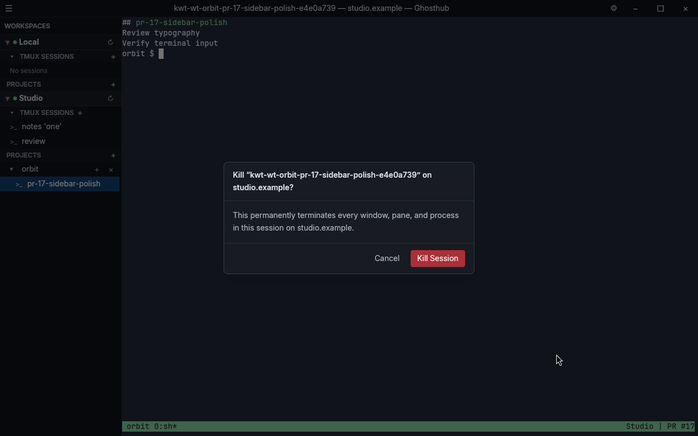

  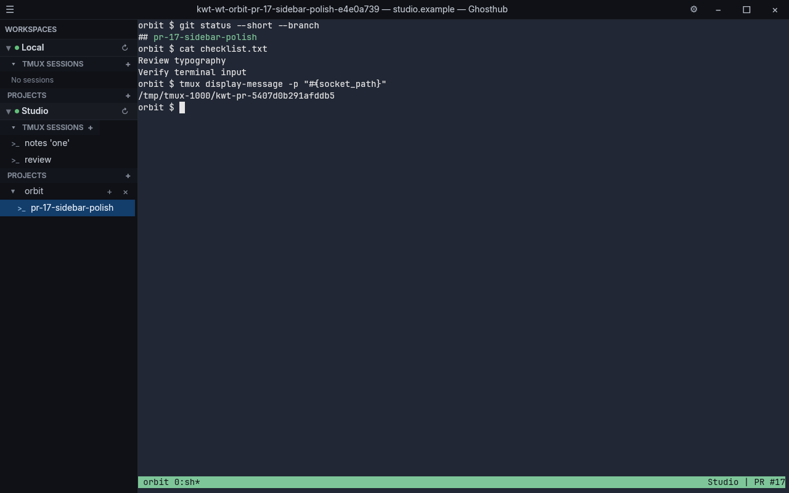

- **Remove ordinary and protected worktrees:** both ordinary and protected
  registered worktrees offer **Remove Worktree** (even with no open terminal).
  Confirmation captures the live session identity on the appropriate socket and
  checks for uncommitted changes. Removal rechecks project registration,
  generation, dirty state, SSH connection, and session identity before killing
  that exact session and asking KWT to remove the checkout. The Git branch is
  preserved.

  If KWT finds uncommitted changes, confirmation warns that staged, unstaged,
  and untracked work will be lost and requires **Force Remove Worktree** (and a
  matching explicit force acknowledgement in the workspace API). A clean
  confirmation cannot authorize force removal if the checkout becomes dirty;
  **Review Again** captures a new confirmation before ending any session.
  Failed or incomplete change checks block removal. KWT refuses deletion if the
  workspace session name exists on the protected endpoint or either shared
  server, or if protected-server topology looks unexpected. Cancel leaves
  everything untouched. The live SSH gate covers Cancel, force review, new and
  replacement sessions, idle removal, and preserving unrelated sessions.

  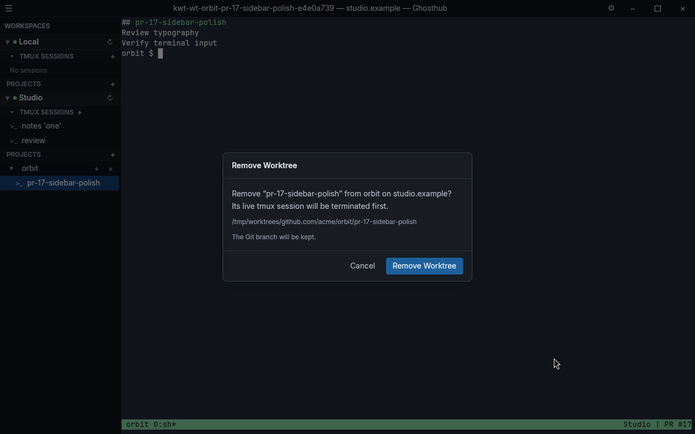

  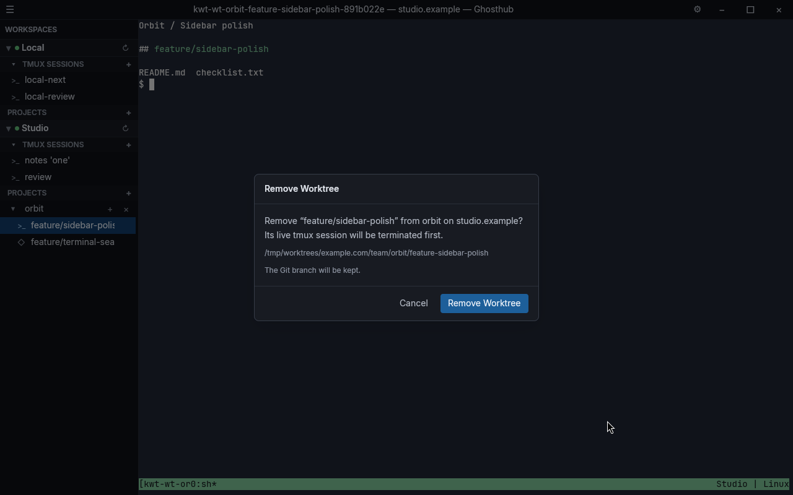

Custom named sockets and automatic transport recovery for these paths remain
separate work. Unsupported actions stay disabled in the remote project tree.

### Windows WSL command boundary

WSL is enabled automatically when system-owned `wsl.exe` exists, without being
required to launch the app shell. The entry point checks the absolute Windows
system path without running WSL or searching `PATH`. If `wsl.exe` is absent, no
WSL host is published; if inspection fails, an unavailable synthetic WSL host
publishes with a classified diagnostic. Linux never publishes a WSL host.

#### Startup, timeouts, and polling cadence

- GPUI paints the shell and disconnected WSL host first, then asks workspace to
  connect enabled hosts on the next frame.
- Discovery may cold-start WSL, keeping Connecting, Ready, empty inventory,
  Timeout, and error states scoped to that host.
- Budgets: 45 seconds for initial refresh, 30 seconds for later refreshes, and
  15 seconds per command. Expiry cancels the active generation and discards
  late results. Retry starts a new generation without altering configured
  distro, binary, socket directory, or identity rules.
- While the window is active, an app-owned timer refreshes a ready WSL host
  every 10 seconds without polling while inactive. Window activation only
  updates in-memory polling/focus state and never runs host commands, process
  sampling, filesystem probes, database work, or reconciliation.
- Connecting, disconnected, and unavailable hosts never auto-retry; their
  Cancel, Connect, and Retry controls stay explicit. Refreshing a ready host
  keeps Ready state, cached rows, and constructive actions visible without
  publishing a transient UI revision. The 10-second timer skips in-flight
  refreshes or session operations, never starts the KWT lane, and reuses the
  admitted tmux cache. A default-distro change always triggers fresh admission
  even if two distros share a kernel boot ID and PID 1 start time.

#### Process containment and exact command shape

Every host command runs inside a disposable descendant container: a
kill-on-close Job Object on Windows (started suspended, assigned to the Job
Object, then resumed to close the post-spawn race) and a dedicated process
group on Unix. Stdout and stderr flow through a bounded fixed-chunk channel
into capped buffers. On exit, timeout, cancellation, or capture failure,
Ghosthub kills the entire container before a bounded output drain so leaked
child pipes cannot hang discovery or pile up threads.

`host` owns all WSL knowledge. It resolves the configured distro (or invokes
the default distro once to read `WSL_DISTRO_NAME`) and pins all later commands
to that exact name instead of parsing localized `wsl.exe --list` output. One
`/usr/bin/cat` call reads `/proc/version`, `/proc/sys/kernel/random/boot_id`,
and `/proc/1/stat` to verify WSL2 and capture shared-kernel and distro-instance
identity.

`host` builds an `AttachPlan` with resolved program and argv, which `terminal`
launches via ConPTY without knowing WSL exists:

~~~text
wsl.exe --distribution <distro> --exec /usr/bin/env \
  TERM=xterm-256color [TMUX_TMPDIR=<configured absolute POSIX path>] \
  <configured absolute POSIX tmux path> if-shell -F -t =<session-id>: \
  <server-pid/session-id/creation-time condition> \
  "attach-session -E -t =<session-id>" \
  "display-message -p <identity-mismatch marker>"
~~~

Every outer argument is passed directly without a shell. The final two entries
are tmux command strings required by `if-shell`, built strictly from validated
live identity values and fixed tokens. Defaults are `/usr/bin/tmux` and tmux's
default socket path; optional config overrides either. Ghosthub does not source
shell startup files, so any shell-set `TMUX_TMPDIR` must also be configured in
Ghosthub.

Discovery runs a single `list-sessions -F` call returning server PID, session
ID, creation time, name, and attached state (never one process per session). If
initial attach fails with tmux's missing/unsuitable terminal error, Ghosthub
unpublishes the failed worker, clears pending paste and input state so nothing
leaks across clients, retries once with `TERM=xterm`, and shows a persistent
reduced-color notice without needing `infocmp`, `tput`, or `ncurses-bin`. Other
local client exits do not loop.

`host` publishes classified diagnostics instead of flattening errors:

- Absent tmux server: successful empty inventory.
- Exec status 127: missing configured tmux binary (points to the override).
- Permission denied: names the executable or socket directory.
- Non-WSL2 kernel: unsupported-environment diagnostic.
- Invalid instance or inventory fields: malformed-output diagnostic.
- Failure starting or talking to `wsl.exe`: transport diagnostic.

Retryable failures stay retryable. Empty inventory states always show the
resolved distro, binary, and default or configured socket directory so an empty
list never hides where Ghosthub looked.

### Optional Herdr capability in WSL

Herdr is an optional capability on the admitted WSL endpoint, not a separate
host or startup requirement. After tmux admission, `host` resolves an exact
absolute `herdr` binary through WSL's POSIX login profile (`/bin/sh -lc` with a
fixed Ghosthub-owned probe), removes every inherited Herdr routing variable
listed in [Terminal Sessions](terminal-sessions.md), and runs
`herdr session list --json` via direct argv. Exit 127 means silent absence;
other executable, permission, transport, or parse errors stay Herdr-scoped
diagnostics without affecting tmux.

- **Shared sidebar list:** running and stopped Herdr sessions appear in the
  host's shared session list with backend labels distinguishing Herdr, tmux,
  and Zellij. The host's **+** menu creates sessions, right-click offers
  **Refresh**, and Connect/Cancel/Retry appear when needed. Refreshing keeps
  cached rows navigable while replacement inventory loads.
- **Runtime fencing:** Herdr executable discovery and inventory sit inside the
  same before/after WSL runtime check as tmux so a distro restart cannot mix
  instances.
- **Attach, create, and restart:** running rows attach via
  `herdr session attach <exact-name>`. Creating a named session consumes a
  non-cloneable authority for `herdr --session <exact-name>` and never replays
  on failure. Both run as ordinary ConPTY clients with Herdr routing variables
  scrubbed, sharing tmux's retained presentation switcher. Selecting a stopped
  row restarts it via the one-shot launch path: plain `herdr` for the default
  session, or `herdr --session <exact-name>` for named sessions. Creation
  validates user-authored names, whereas Restart passes the discovered name
  unchanged so newer naming rules never orphan older sessions. The captured
  default-session role is checked alongside state and paths.
- **Confirmed Stop and Delete:** both require confirmation, then revalidate WSL
  runtime, executable, expected running/stopped state, session directory, and
  socket, with a final runtime check right before running the command. A
  per-session guard blocks duplicate actions, and a workspace operation fence
  serializes attach, retained retry, create/restart, and lifecycle commands so
  an older launch cannot finish after Stop or Delete. Stop closes matching
  presentations first; Delete is available only for stopped non-default
  sessions. Guards stay active until fresh inventory or a classified failure
  publishes, and every mutation advances the inventory generation to cancel
  older refreshes. Rust never treats Herdr as tmux-compatible or uses Herdr's
  remote mode.

### Optional local Zellij capability

Zellij is a third optional capability on native Linux and WSL endpoints. `host`
resolves one absolute binary via the POSIX login profile, scrubs `ZELLIJ`,
`ZELLIJ_PANE_ID`, and `ZELLIJ_SESSION_NAME`, and invokes
`zellij list-sessions --no-formatting` via direct argv. Exit 127 is silent
absence, Zellij's exact no-active-sessions message is empty inventory, and
other errors stay Zellij-scoped. Exited/resurrectable entries are excluded.

- **Sidebar and attach/create:** Zellij rows appear alongside tmux and Herdr
  with backend labels. The host's **+** menu creates sessions for each
  available backend plus **Add Project…**. Right-clicking a row or clicking its
  hover **…** menu offers detach or confirmed destructive actions. Opening an
  active Zellij row uses an attach-only `zellij attach <exact-name>` plan;
  creating consumes a non-cloneable `zellij --session=<exact-name>` launch.
  Both run as ordinary local PTY clients, share the retained switcher, never
  replay creation, and only detach on close.
- **Confirmed Kill Session:** `host` checks the Linux runtime, absolute binary,
  and exact active name, closes matching views, and rechecks all three right
  before running `zellij kill-session -- <exact-name>`. Attach, create, and
  kill share the serialized session lane so an older launch cannot land after a
  kill. Because Zellij has no stable generation ID, the same-name replacement
  race noted in [Terminal Sessions](terminal-sessions.md) remains an explicit
  backend limit.

### Terminal ownership

`terminal` owns all terminal semantics, not just VT parsing. `ui` only converts
GPUI events to neutral input types through `workspace` re-exports. `terminal`
owns:

- Mode-aware key encoding.
- Mouse protocol encoding and coordinates.
- Bracketed-paste framing and unsafe-paste confirmation.
- OSC 52 parsing effects and clipboard policy.
- PTY client lifecycle.
- Resize ordering.
- Terminal backend adaptation.
- Surface buffer publication.

The VT backend stays private. Keyboard events pass through libghostty's encoder
using current terminal modes, while paste approval/sanitization, clipboard
policy, and SGR mouse routing stay Ghosthub-owned.

Input fixtures feed mode-setting sequences into the terminal before encoding
platform events, covering Kitty keyboard levels, `modifyOtherKeys`,
cursor/keypad application modes, bracketed paste, AltGr vs Ctrl+Alt, dead keys,
and IME composition. The input model keeps logical unmodified keys, produced
text, and press/repeat/release event types separate so Kitty alternate-key and
event reporting never reconstructs them from bytes.

Clipboard policy matches the Swift app: local and remote tmux surfaces may
write the system clipboard via OSC 52 when `clipboard-write` is enabled, and
toggling it in **Settings → Terminal** takes effect immediately on open,
retained, and future presentations. Remote OSC 52 reads always get an empty
response regardless of `clipboard-read`; local OSC 52 reads follow the local
setting. Only an explicit user paste reads the clipboard for PTY input, with
bracketed-paste framing and unsafe-paste checks applied by the terminal worker.
OSC 52 writes, remote-read denial, and explicit paste are all part of the
Windows WSL MVP.

### PTY and worker flow

Because Windows ConPTY exposes a blocking anonymous-pipe reader via
`portable-pty`, the native terminal pipeline uses:

- One dedicated reader thread.
- One depth-one rendezvous handoff with reusable ~64 KiB buffers.
- One serial terminal worker selecting between the byte handoff and ordered UI
  commands.
- OS-pipe backpressure when the handoff is full.

Spawning lives in one shared PTY process layer (see [Web UI](web-ui.md)) that
owns command intake, PTY creation at initial geometry, child spawn, Job Object
containment, resize delivery, shutdown order, and child reaping.
`TerminalWorker` (parsed, native) and `ByteRelayWorker` (parserless, per web
viewer) are separate consumers, keeping one VT interpreter per PTY. The relay
forwards device queries verbatim; ConPTY sends a cursor-position query at
startup and blocks until answered, so relay viewers must run a real VT frontend
such as xterm.js. A relay viewer that fails to drain its bounded output queue
is disconnected with a backpressure outcome and torn down; reconnecting opens a
fresh attach client.

On Unix, the shared process layer uses nonblocking PTY descriptors with
interruptible readiness waits so teardown cancels waits before reaping. A
saturated Linux PTY write can stay blocked even after the slave process exits,
so killing the child alone cannot bound shutdown. Live clients keep partial-I/O
reads and writes; shutdown may drop undelivered input. Windows keeps the ConPTY
pipe path.

The core invariant is bounded, non-lossy delivery without blocking the UI:

- PTY output bytes are never dropped or placed in unbounded queues.
- Non-coalescible UI input uses an ordered queue bounded by both command count
  and payload bytes. GPUI keeps backpressured input in a smaller bounded retry
  buffer and shows a busy notice only if that buffer fills too.
- Paste approval and cancellation use a separate bounded control lane so
  confirmations never stall behind queued input.
- Resize and mouse motion use bounded latest-value slots; key, button, paste,
  and protocol-response commands flush earlier motion into the ordered lane
  first to preserve ordering.
- Worker-to-UI paint frames use latest-value publication; semantic effects use
  a reliable low-volume channel.

### Surface buffers and damage

The backend-neutral `ghosthub-surface` leaf crate (shared by `terminal`,
`workspace`, and `ui`) exposes Rust-owned paint buffers, dimensions,
generations, cursor/selection overlays, damage, and leases, with zero PTY, FFI,
backend, process, config, or GPUI dependencies.

Publication uses a bounded reusable-buffer mailbox. Returned buffers carry
their generation so the worker applies accumulated damage since that generation
before republishing, while unpublished frames coalesce in a latest-value slot.
Resize, theme invalidation, or missing damage history triggers full damage. UI
paints directly from its leased buffer without per-frame grid copies.

Scroll is modeled as a first-class damage operation (shift a row range by a
signed delta, then dirty newly exposed or edited rows). Because `libghostty`
1.0 currently marks every row dirty on viewport scroll, the adapter compares
rows and reuses unchanged owned cells, though it still converts the visible
grid on scroll while ordinary edits convert only dirty rows. This is a known
migration trade-off where the earlier engine's incremental scroll-conversion
benchmark is not yet met.

### Resize authority

GPUI measures the active font's glyph advance, ascent, and descent through its
text system. That cell width and line height is the single source for
rendering, grid dimensions, wheel scaling, and mouse hit testing. GPUI sends
the latest resize (sequence, grid, and pixel dimensions); the worker coalesces
stale resizes and updates terminal state and PTY winsize together.

Every surface frame carries its generation, resize sequence, grid size, and
pixel size. GPUI letterboxes stale frames instead of stretching an old grid
into new geometry.

### Verified mux capabilities and live identity

`VerifiedTmuxBinary` holds an absolute path, a protocol version of at least
3.2, and a probed `MuxCapabilities` set. Version numbers alone do not prove:

- `new-session -A` atomic create-or-attach.
- `new-session -e` environment injection.
- `attach-session -E`.
- Exact `=name` targets.
- Isolated non-default server namespaces.
- Stable session and server-instance identity.

#### Rejected psmux 3.3.7 probe

The initial Windows probe tested psmux 3.3.7 (`05cc5d4`, SHA-256
`8A2370A98C47F5FF68DA4A317BFBAF4316DF19FE990B839BDACF856BEBC00405`) under an
isolated `-L ghosthub-test-*` namespace. It passed `new-session -A`,
`new-session -e`, exact `has-session`, stable `$3` identity across rename,
server PID change on restart, and namespace isolation. However,
`kill-session -t =name` left the session alive after five seconds, and
`attach-session -E` stayed unproven. `cargo test-psmux-live` remains an opt-in
regression test that passes by rejecting this build rather than trusting
version or help strings; it is not a Windows MVP gate.

The experimental Swift remote-Windows path uses the same psmux build but kills
by session ID after resolving exact identity rather than issuing the failing
`=name` kill. Its conditional-kill flow still needs isolated end-to-end
verification; the Rust rejection neither makes that Swift path dead code nor
proves false success.

#### WSL2 tmux admission

The Windows MVP instead verifies POSIX tmux inside WSL2:

- `host` locates `wsl.exe` through `GetSystemDirectoryW` (never `PATH` or the
  current directory) and prefixes every command with `--distribution <name>
  --exec`, using POSIX paths such as `/usr/bin/tmux` and `/dev/null` with
  `ExecutablePlatform::Posix` (while contract platform stays Windows). WSL
  fixtures use their own strict ID/shape without altering the psmux fixture
  schema.
- All seven mux capabilities remain mandatory even in the attach-only MVP.
  `host` runs command-only checks on an isolated server, then `workspace` runs
  real ConPTY admission clients through `TerminalWorker` (so the second
  `new-session -A`, environment positive control, and `attach-session -E`
  proofs execute as ordinary PTY clients).
- The positive control adds a sentinel variable to `update-environment`, checks
  that attaching without `-E` overwrites the session value, resets the
  sentinel, and checks that attaching with `-E` leaves it unchanged.
- Before creating the probe session, `host` picks a random mode-0700
  `TMUX_TMPDIR` and installs its RAII cleanup guard first so cancellation cleans
  up reliably. For uncertain creation where stopping the Windows relay does not
  prove the Linux command exited, cleanup retries removal over a two-second
  monotonic settle deadline before a final absence check.
- Discovery, admission, and attachment all run through
  `env -u TMUX -u TMUX_PANE` so launcher variables cannot redirect sockets.
- No `VerifiedTmuxBinary` is produced until every check passes; any failure
  unwinds the isolated server and leaves admission retryable.

`VerifiedKwtHelper` requires the exact revision, verified SHA-256, and
revision-scoped managed path.

Cached inventory is display-only. `LiveIdentity` has private fields and can be
constructed only from a fresh length-framed all-session query right before a
destructive action. `host` matches decoded display names in Rust so display
names never enter a tmux target expression; conditional kill targets the
captured session ID while comparing server PID, session ID, and creation time.
`store` cannot depend on `session` or serialize runtime authority.

### Presentation registry

`ghosthub-app` builds one `PresentationRegistry` and injects it (never as
static global state). During attach, an RAII `PresentationLease` reserves the
effective endpoint (resolved SSH hostname, port, and user, or resolved WSL
distro name), socket, and requested exact name. Kernel boot ID plus
`/proc/1/stat` field 22 form a separate runtime instance identity so a distro
restart is caught even when the shared WSL2 kernel stays up. After a fresh
query, promotion atomically replaces the reservation with the live key:

~~~text
endpoint + runtime instance + socket + server PID + session ID + session creation time
~~~

Session name is display metadata, not instance identity: renaming updates the
display name while keeping the presentation attached, and a server restart
produces a new live key even if a session ID is reused. If two reservations
promote to the same live key, the first wins; the loser closes its client,
releases its lease, and focuses the winner. `Drop` releases leases on normal
close, PTY EOF, error, and unwind.

### Windows WSL relay and server lifetime

The WSL2 tmux server runs inside the WSL utility VM, not as a Windows child
process, so a Windows Job Object cannot kill the server when a presentation
closes. `terminal` owns only the disposable ConPTY and `wsl.exe` attach relay.

Ghosthub pins `portable-pty` 0.9.0 (verified through `cargo-deny`, with its raw
Windows child-handle API rechecked on every upgrade) and assigns every spawned
relay to an app-owned Job Object with `JOB_OBJECT_LIMIT_KILL_ON_JOB_CLOSE`,
verifying membership with `IsProcessInJob`. Forced Ghosthub termination reaps
the Linux-side tmux client while the server stays alive outside the job.

If job creation, assignment, or membership verification fails, Ghosthub closes
the PTY master, waits briefly for the relay, falls back to client termination if
needed, releases the reservation, and only then reports a diagnostic. Because
`portable-pty` cannot start processes suspended, a small spawn-to-assignment
race is accepted, and a presentation becomes active only after membership is
proven.

#### Unsafe code policy

The workspace sets `unsafe_code = "deny"` (changed from `forbid`) and
`unsafe_op_in_unsafe_fn = "deny"`, with narrow module-scoped exceptions:

- Windows `terminal` wraps `CreateJobObjectW`, `SetInformationJobObject`,
  `AssignProcessToJobObject`, and `IsProcessInJob` behind a safe RAII API.
- Windows `host` wraps `GetSystemDirectoryW` to locate the trusted WSL
  launcher.
- Private `terminal::vt` wraps documented libghostty FFI calls and owns every
  allocation through destruction (`Send` for worker ownership, never `Sync`).

Every other module keeps the denial, and the architecture test verifies that
all `ghosthub-*` crates inherit `[lints] workspace = true`. Windows uses
`windows-sys` 0.61.2 (already pulled in by GPUI 0.2.2) instead of adding
another version.

#### Forced-termination matrix

The live integration suite kills the presentation or app child both gracefully
and forcibly, then launches a fresh child and reattaches to the same identity:

| Platform/context | Forced termination | Required result |
| --- | --- | --- |
| macOS Swift gate | `SIGKILL` | tmux server/session survives |
| Windows WSL2 ordinary process | `TerminateProcess` | relay/client exits; exact tmux identity survives |
| Windows WSL2 inherited job | Close/terminate containing process | client-only job reaps relay; exact tmux identity survives |
| Windows job assignment or membership failure | No promoted presentation | spawned relay is unwound before diagnostic |

This covers Ghosthub presentation and app death. It does not promise survival
across `wsl --shutdown`, distro termination, or a Windows restart of the WSL
instance (which the runtime instance identity distinguishes from disappearance
inside the same instance).

## 3. Workspace and State Ownership

### Rust packages

Workspace directories use short names with namespaced Cargo packages:

| Directory | Cargo package / output | Responsibility |
| --- | --- | --- |
| `model` | `ghosthub-model`, lib `model` | Pure domain values and classified diagnostics |
| `input` | `ghosthub-input`, lib `input` | Backend-neutral terminal input events, modes, and encoding |
| `surface` | `ghosthub-surface`, lib `surface` | Rust-owned terminal paint vocabulary |
| `session` | `ghosthub-session`, lib `session` | Launch capabilities, verified mux/helper capabilities, live identity |
| `config` | `ghosthub-config`, lib `config` | Path resolution and read-only/writable preferences |
| `store` | `ghosthub-store`, lib `store` | SQLite records and attach-only descriptors |
| `host` | `ghosthub-host`, lib `host` | Local/WSL/SSH resolution and inventory, kwt, muxes, managed helpers |
| `terminal` | `ghosthub-terminal`, lib `terminal` | `TerminalEngine`, resolved-client PTY worker, input, clipboard, surface publication |
| `workspace` | `ghosthub-workspace`, lib `workspace` | Inventory reconciliation, actions, selection, restoration |
| `ui` | `ghosthub-ui`, lib `ui` | GPUI windows and elements |
| `app` | `ghosthub-app`, bin `ghosthub` | Application entry point (composition root) |

Allowed internal dependency edges:

~~~text
app
├── ui ─────────→ workspace, model, surface
├── workspace ──→ host, terminal, store, session, config, model, surface, input
├── host ───────→ session, config, model, contracts (development only)
├── terminal ───→ session, config, model, surface, input
├── store ──────→ model
├── session ────→ model
├── config ─────→ model
├── surface ────→ (leaf)
└── input ──────→ (leaf)
~~~

Cargo metadata tests check normal, build, and development dependencies against
this exact allowlist and enforce `[lints] workspace = true` on every
`ghosthub-*` crate. Test fixture consumers declare their dev dependency on
`contracts` separately. `store` can never reach `session` transitively. `ui`
may depend directly only on `workspace`, `model`, and `surface` (naming neutral
input values through `workspace` re-exports, and receiving config only through
workspace-projected view state). Negative persistence tests live in `contracts`,
which may depend on both `store` and `session`. Static trait checks guard
against accidental serialization; manual store structs that duplicate authority
fields remain a human-review check.

### Roots and managed helpers

`GhosthubHome` is the shared per-user root:

| Platform | Ghosthub home | Config | State | Local managed-helper namespace |
| --- | --- | --- | --- | --- |
| POSIX | `$HOME/.ghosthub` | `$HOME/.config/ghosthub` | Ghosthub home itself | `GhosthubHome/helpers` |
| Windows | `%USERPROFILE%\.ghosthub` | `GhosthubHome\config` | `GhosthubHome\state` | `GhosthubHome\helpers` |

`GHOSTHUB_HOME` moves the local root and its helper namespace.
`GHOSTHUB_CONFIG_HOME` moves only config; `GHOSTHUB_STATE_HOME` moves only
state and never moves helpers. Keeping POSIX state directly in `GhosthubHome`
matches the shipped macOS app. Local KWT operations always use the packaged
pinned helper, never a binary discovered on `PATH`.

#### Bundling and activating local helpers

- **Linux:** `make bootstrap-kwt` stages `.build/kwt/kwt` (or
  `GHOSTHUB_KWT_BUNDLE`). Cargo embeds it and fails release builds if it is
  missing or mismatched. Activation uses the resolved helper root (respecting
  `GHOSTHUB_HOME`).
- **Windows:** `tools/build_rust_kwt.ps1` cross-compiles `KWT_REVISION` for the
  WSL Linux architecture, and Cargo embeds the Linux binary, its SHA-256, and
  revision (verifying ELF architecture and revision bytes; release builds fail
  without a valid bundle). `host` activates it atomically inside WSL and checks
  both SHA-256 and reported revision before every operation, reinstalling if
  missing and rejecting modified bytes. Developer builds may omit the bundle,
  which disables KWT inventory only.

Windows Cargo builds also embed and validate the native Windows PE KWT
controller alongside the Linux helper. The PE controller stays a packaged
contract artifact rather than the Windows SSH path because Windows OpenSSH
lacks the Unix-domain ControlMaster socket required by KWT's daemon lease;
Windows SSH runs the Linux helper and `/usr/bin/ssh` inside WSL instead,
activating it under its content-addressed WSL path and rejecting modified bytes
rather than overwriting in place.

#### Local KWT inventory and project workflows

KWT project and worktree reads run on a cancellable lane separate from tmux,
Herdr, and Zellij inventory. The 10-second session timer never installs KWT,
invokes KWT, or replays worktree reconciliation. Each KWT inventory pass makes
three machine-readable calls: registered projects, global worktrees, and
directory workspaces. After the host first publishes, Rust runs one background
KWT read and refreshes it every 60 seconds while the window is active (manual
refresh supersedes both). Failed or in-flight reads retain the last good
project tree without touching session availability or open terminals.

- **Add and remove projects:** when local KWT inventory is ready, the Projects
  header shows **Add Project**. On Linux, pick a folder or enter an absolute
  POSIX path. On Windows, the folder picker accepts Windows paths (resolved
  through the distro's `wslpath`) and matching `\\wsl.localhost\<distro>\...`
  UNC paths (rejecting UNC paths from other distros), plus explicit POSIX
  paths. Registration runs `projects add <path> --json`. Confirmed **Remove
  Project** (`×`) re-reads inventory and runs
  `projects remove <exact-path> --expected-repository <credential-free-id>
  --expected-registration <opaque-fingerprint> --json`, rejecting empty or
  missing fingerprints. Unregistering changes KWT metadata only and never
  deletes repositories, worktrees, or tmux sessions. Ghosthub never scans WSL
  or edits KWT config directly.

  

- **Serialized mutations and socket env:** project mutations share a background
  lane separate from GPUI and terminal workers, keeping the prior tree visible
  while running. Successful mutation responses publish right away and are
  followed by full reconciliation; a failed reconciliation never hides a
  confirmed add or brings back a confirmed removal. Mutations supersede older
  reads only, ordinary cadence waits for them, and commands that may have
  crossed the process boundary are never cancelled or silently retried. KWT
  receives configured `TMUX_TMPDIR` for default-server work, while Ghosthub
  clears `TMUX_TMPDIR` for KWT's named sockets (including protected imports).

- **Create and open branch worktrees:** each project loads `branches --json`
  and creates a new branch (`add --branch`) or imports an existing local/remote
  branch (`add`, optionally `--from`) with `--no-launch`, passing
  `--expected-repository` and `--expected-registration` so KWT verifies
  ownership under its lifecycle lock. After creation, Rust refreshes inventory
  and selects the exact returned worktree (or retains a pending identity if
  immediate refresh is unavailable, opening it on the next matching refresh
  only if the user's navigation generation has not changed; otherwise showing a
  notice).

  Opening a worktree uses cloneable `RepairOrOpen` authority (never one-shot
  creation): the terminal invokes the pinned helper with repository,
  registration fingerprint, generation, and session name, and KWT revalidates
  under its lock before repairing or starting tmux. Once a default-socket
  worktree client resolves its live tmux identity, its presentation key
  normalizes to that identity so the client stays reusable even if KWT later
  associates or unlinks the project. KWT-only validation failures stay scoped
  to the worktree action.

  

- **Sidebar projection and confirmed removal:** by default, KWT-owned
  default-socket tmux sessions appear under their project/worktree rows and are
  hidden from the standalone session list. Disabling **Hide sessions that
  belong to a worktree** shows them in both places. When hidden, active and
  retained custom-socket views owned by a current worktree stay accessible from
  that worktree row (keeping their socket, path, and generation); if current
  inventory no longer owns that view, it falls back to a standalone row rather
  than hiding under a replacement worktree. Standalone Kill and Open queries
  always revalidate the exact socket.

  Local **Remove Worktree** inspects the exact checkout before confirmation and
  captures live tmux identity and socket if running. Dirty checkouts require
  **Force Remove Worktree** (and a matching API force acknowledgement),
  discarding staged, unstaged, and untracked changes while keeping the Git
  branch. A fresh check right before killing the session rejects newly dirty
  checkouts and offers **Review Again**; failed or incomplete checks block
  removal. After exact kill, pinned KWT runs absence-guarded removal under its
  lifecycle lock, tombstoning the path and generation in the cached tree
  immediately so a KWT outage cannot resurrect a deleted row.

  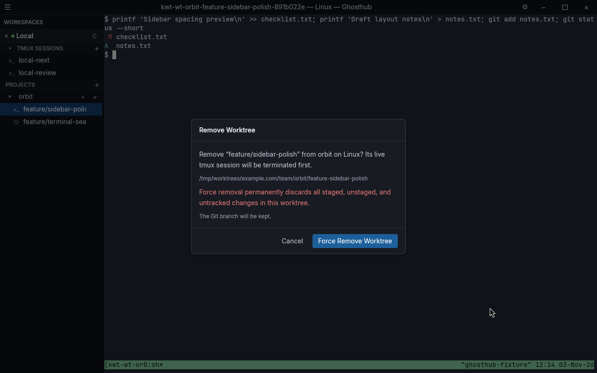

- **Local pull-request import and protected attach:** the pinned helper is the
  only provider API for listing and importing PRs into a registered project.
  Ghosthub filters title, author, branch, number, URL, and draft fields locally
  and sends the selected candidate's opaque KWT selector back unchanged (typed
  input accepts only an exact loaded selector, PR number, or URL). Imports must
  return the expected project path plus a protected worktree with generation,
  exact session name, and non-empty socket name; Ghosthub refreshes inventory
  before publishing or opening. Candidate discovery is user-triggered with a
  cancellable five-minute budget.

  Protected PR worktrees open through `kwt pr attach` with exact project,
  registration, generation, session, and socket identity; KWT revalidates under
  its lifecycle fence before repairing or starting tmux, workspace rechecks
  after launch, and readiness is confirmed by finding the client PID on that
  protected socket. Protected views never alias default-server sessions with
  the same name, and removal uses the same exact-kill plus absence-guarded KWT
  removal (serialized by KWT's lifecycle fence against concurrent reopens).

#### Remote helper matrix

Remote helper activation uses one cross-controller path contract (matching
`Sources/App/KwtBinaryLocator.swift`):

- POSIX remote: `$HOME/.ghosthub/helpers/kwt/{revision}/kwt`
- Windows remote: `%USERPROFILE%\.ghosthub\helpers\kwt\{revision}\kwt.exe`

Remote controllers ignore `GHOSTHUB_*` overrides on the remote host so every
controller finds the same helper revision. If a remote home directory is
missing or unwritable, installation fails with an actionable diagnostic rather
than offering a remote path override. This trade-off keeps paths predictable
across hosts.

Rust builds embed the pinned remote helper matrix (macOS and Linux on x86_64
and arm64). `make rust-build` and `make rust-test-ssh-live` stage it through
`ensure-kwt-variants`, `KWT_VARIANTS_DIR` accepts a prebuilt directory, and
`GHOSTHUB_KWT_VARIANTS_DIR` passes it directly to Cargo. Release builds and
`GHOSTHUB_REQUIRE_KWT_BUNDLE` fail on an incomplete matrix.

Remote inventory and project mutations reuse the reviewed SSH lease, one KWT
operation per host. Checksums and revisions are verified before use; updates
upload to a unique temporary path and activate atomically after verification.
Closing the owning scene cancels its operation, reconnect fences stale reads
and triggers a fresh read, failed reads keep the last good tree with a
diagnostic, successful registration receipts survive failed reconciliation, and
only explicitly retryable reads retry (never mutations).

### KWT-owned SSH boundary

Rust never reimplements OpenSSH config parsing, `ProxyJump` expansion,
host-key or auth prompts, or `ControlMaster` lifecycle.

- **Route resolution:** Linux activates the pinned native KWT bundle as its SSH
  controller under the resolved helper root. Windows invokes the pinned Linux
  controller inside WSL via `wsl.exe --distribution <distro> --exec` running
  argv-only `kwt ssh resolve --json`, with WSL's `/usr/bin/ssh` owning masters
  and clients. Every Windows SSH command checks the captured WSL kernel boot ID
  and distro PID 1 start time inside the same `wsl.exe` call so a distro
  restart invalidates routes, leases, inventory, and attachments. There is no
  fallback to native Windows OpenSSH, masterless leases, or unguarded direct
  SSH. `host` accepts only projection policy `kwt.openssh.projection.v2` as an
  immutable snapshot; owner-private projection lines are redacted from debug
  output and never reconstructed.
- **Leases and prompts:** `kwt ssh lease --json` runs bound to the route
  identity and projection policy. Its NDJSON stream must maintain one operation
  ID, contiguous sequence numbers, exact hop attribution, and one terminal
  result. Host-key prompts display KWT's host, algorithm, and fingerprint; auth
  prompts are masked, held only until the one-shot reply is sent, and never
  persisted or logged. Both keep KWT's deadline and exact logical, effective,
  and display targets. Changed routes, masterless results, malformed events, or
  attribution mismatches fail closed. Cancel returns that host to disconnected
  state without affecting other hosts, and stale prompt generations are
  rejected.
- **Lease lifetime and arguments:** a successful lease returns option-only
  `-F`/`-o`/`-S` arguments; Ghosthub appends the reviewed logical destination
  once before the remote command. `host` keeps the lease process alive while
  any presentation uses it, closes stdin on final release, and kills it on
  cancellation or protocol error. While Ready, nonblocking event polling checks
  the controller; an unexpected exit drops the lease, cleans up descendants off
  the UI thread, discards remote runtime context, and marks the host
  unavailable before any command can reuse its arguments. Cancelling or failing
  a refresh discards stale host context while retained presentations keep their
  own explicit lease ownership. `terminal` never knows about WSL, KWT, routes,
  or SSH; it receives only resolved program and argv. Lease authority is never
  serialized.
- **Settings and explicit connect:** the native Settings shell (modeled on the
  Swift app with stable domain navigation, page header, and detail regions)
  exposes the **Hosts** pane to add, edit, or remove POSIX SSH hosts (name,
  hostname, optional user/port, optional absolute tmux path and `TMUX_TMPDIR`).
  Saving updates only Rust config. Configured hosts start disconnected and
  never open network connections until you click **Connect**.
- **Remote discovery, terminfo, and launch:** after admission, `host` probes
  tmux, Herdr, and Zellij independently over the lease (backend failures stay
  scoped, and tmux failures stay visible under the host's list so paths can be
  fixed). Before launching any remote tmux, Herdr, or Zellij client, `host`
  checks remote terminfo and picks `xterm-256color` when present or `xterm`
  otherwise (showing the reduced-color notice only after a fallback client
  opens). Collapsing a host never detaches clients.
- **Remote creation, errors, and locale:** constructive actions re-probe over
  the lease off the UI thread and publish only an exact post-launch inventory
  match. Remote tmux creation runs one atomic `new-session -A -E` client with a
  nonce-scoped receipt reporting server PID, session ID, and creation time
  (with bounded read deadline and best-effort cleanup); later opens are
  attach-only. Interactive tmux clients inherit the remote login locale, while
  inventory queries force the C locale for parsing. Nonzero remote client exits
  report exit status without copying terminal bytes or control sequences;
  attachment identity mismatches keep their specific error, and exit 0 detaches
  silently. Remote worktree removal holds both the KWT and session operation
  lanes, tombstones confirmed removals before reconciliation, cancels pending
  destructive work on reconnect, and requires a bound force acknowledgement for
  dirty checkouts. Retained-client reconnect and app-state restoration stay
  separate work; absent controls never silently fall back to WSL or unguarded
  SSH.

#### Config and state path resolution

Config root precedence:

1. Valid `GHOSTHUB_CONFIG_HOME`
2. Valid `GHOSTHUB_HOME` with `config` appended
3. Platform default

State root precedence:

1. Valid `GHOSTHUB_STATE_HOME`
2. Platform state mapping from `GhosthubHome` (the root itself on POSIX,
   `state` child on Windows)

Rust ignores `XDG_CONFIG_HOME` and `XDG_STATE_HOME` (Linux's fixed config
default matches `~/.config/ghosthub`, and relocation uses
`GHOSTHUB_CONFIG_HOME`). All inputs and defaults must be local absolute paths:
Windows accepts drive-rooted paths and rejects drive-relative, root-relative,
UNC, and user-supplied device/verbatim paths. A UNC `%USERPROFILE%` or an
invalid explicit override produces a blocking startup diagnostic instead of
silently falling back. Windows builds enable long-path awareness and may use
extended-length paths internally. Environment, home directory, and platform
path predicates are injected so contract tests run both flavors on any host,
with no config-home file redirect or filesystem dependency.

### Process and concurrency ownership

Ghosthub runs as a single UI process with no Ghosthub-owned daemon or
Middleman. External tmux and psmux servers outlive it. App-owned utility PTYs
(such as a log viewer) live only as long as the app.

Per host:

- Serialized mutations order helper installs, project/worktree lifecycle, and
  session destruction.
- Concurrent reads run inventory, probes, capability checks, and connection
  tests.
- Reads are cancellable and superseded by newer reads of the same kind.
- Every operation has a timeout.

**UI responsiveness invariant:** GPUI activation, input, painting, and snapshot
reads never run host commands, filesystem probes, database transactions, KWT
reconciliation, or resource sampling. Background read lanes build owned results
before taking the brief publication lock (no publication lock crosses I/O,
process waits, or `await`). Runtime-only tmux, Herdr, or Zellij updates never
replay project/worktree reconciliation, and each host publishes independently
so one slow host never blocks another.

Refresh generations advance monotonically; late, cancelled, or timed-out
results with older generations are discarded. An unreachable host with cached
inventory shows it as stale/display-only; without a cache, it shows an
unavailable state with a retryable diagnostic. Neither grants attach or kill
authority.

### Store and reconciliation

- SQLite runs in WAL mode with a single writer task reading from a bounded
  non-lossy `mpsc` queue. No database transaction or connection guard crosses
  an `await` point, and UI submission never blocks on queue space or disk.
- High-frequency writes (geometry, selection, presentation history, last-viewed
  timestamps) coalesce by stable key. Durable writes use async acknowledgement
  off the GPUI thread, with a bounded flush on shutdown.
- Persisted history is display-only and may hold attach-only descriptors, never
  creation, repair, or kill authority.
- The Reconciler consumes only published inventory generations from host read
  lanes; it never probes hosts or derives liveness independently. Runtime and
  cold-start reconciliation may mark records stale or clear metadata, but never
  kills a server session.
- Pending restoration is attach-only and expires at the earliest of three
  failed host refreshes, ten minutes after scene activation, or user
  navigation, returning to navigation with an explicit retry so a host
  returning hours later never steals focus.

### Compatibility contracts

The repository-root `contracts/` manifest defines stable IDs, schema versions,
platform tags, suites, and paths. Rust suites enumerate every applicable entry
and fail on unknown, missing, duplicate, unsafe, or unconsumed fixtures. The
first suite covers POSIX and Windows root resolution, and new gates add their
fixtures and consumers together. `cargo test-contracts` runs manifest, path,
and Cargo-architecture checks in Windows and Linux CI. A future Swift adapter
can consume the same manifest without blocking Rust delivery.

Planned corpus coverage:

- KWT inventory and worktree create, branch import, and PR import lifecycles.
- tmux/psmux resolution, capabilities, identity, and exact commands.
- SSH exits, reconnect/backoff, and host-key/auth/askpass prompts.
- Path roots and platform absoluteness rules.
- Attach-only restoration and display-only history.
- Console Panel and utility-PTY lifetime.
- Terminal input with modes, AltGr, dead keys, and IME.
- Clipboard and paste policy.
- Surface resize, damage, scroll, and snapshots.

### Remote Rex windows

On Linux, a Rex sidebar row opens one remote window over its host's reviewed
SSH route (including hosts over Tailscale MagicDNS). The managed, pinned KWT
helper runs `rex ls --json`, `rex control WINDOW_ID`, and each
`rex attach BLOCK_ID` process. Rex must already be installed and running under
the remote SSH account; Ghosthub neither starts Rex nor opens a Rex network
listener.

- **Ownership and panes:** `host` decodes KWT inventory/control messages and
  owns the bounded control process; `workspace` owns the window and pane
  clients. The focused pane occupies the scene's standard terminal-worker slot
  (inheriting normal input, selection, paste confirmation, and clipboard
  policy), while unfocused panes keep their clients and surfaces with clipboard
  writes disabled. Pane identity preserves clients across layout updates. Only
  tiled terminal panes are drawn.
- **Dedicated SSH connections:** Rex control and pane clients use separate
  KWT-managed SSH connections from tmux and inventory. Each extra connection
  carries up to eight Rex sessions before Ghosthub opens another; if a server
  enforces a lower cap, Ghosthub retries the refused pane or window on a new
  connection (which may prompt for authentication). One failing pane leaves its
  neighbors usable.
- **Layout controls and lifetime:** Rex confirms split, resize, focus, zoom,
  and close over its control channel. Directional focus follows the window
  shown in Ghosthub rather than Rex's global active window, divider drags send
  one resize on release, and closing a pane requires confirmation bound to that
  exact presentation and SSH connection. Switching away or detaching closes
  pane clients and the control channel while leaving Rex's programs running.
  Connection failures show a **Reconnect** action without recreating programs.
  Local Rex discovery remains separate work.
- **Live Rex tests:** run `make rust-test-rex-live REX_BINARY_PATH=/absolute/path/to/rex`
  on Linux. The OpenSSH fixture isolates server, sockets, account, and data in
  a private filesystem and network. Desktop checks require Xvfb, xdotool, and a
  software Vulkan driver (`XDTOOL_BINARY_PATH` and `VK_ICD_FILENAMES` override
  non-system locations) and verify keyboard routing after pane changes and
  Command Palette navigation in the real GPUI app. Workspace checks drive
  discovery, control, input, split, focus, zoom, divider resize, pane close,
  detach, and reopen against a real Rex server. Linux CI downloads a fixed
  public server archive verified by SHA-256 (update both URL and checksum in
  `rust-port.yml` together); no Rex binary ships with Ghosthub.

## 4. First Vertical Slice and Delivery

### Blocking foundation gates

Windows product UI integration begins only after these gates close:

| Gate |
| --- |
| Establish Rust contracts, architecture checks, and `cargo-deny` |
| Select the VT backend and prove reusable scroll-aware surface publication |
| Admit `portable-pty` and the terminal engine through the license closure |
| Prove WSL2 ConPTY I/O, client Job Object containment, relay teardown, and application-death survival |
| Verify WSL tmux commands, isolation, identity, and all seven required capabilities |

Prototypes may exercise GPUI or candidate backends, but product crates never
expose provisional backend-specific APIs.

### Slice 1: local attach only

The first milestone opens a native Windows GPUI shell independently of WSL,
discovers and attaches to an existing tmux session in one resolved WSL2 distro
when `wsl.exe` exists, and detaches without killing the session. It provides a
synthetic host list, discovered-session list, one visible terminal view,
cancellable WSL startup state, and host-scoped retryable diagnostics.

#### Shell, retained presentations, detach, and kill

- The shell keeps host and session navigation mounted alongside the active
  terminal. Every opened session retains its ordinary client, worker, and
  surface keyed by exact host, endpoint, socket directory, session, and live
  identity. Switching sessions hides the current surface without detaching and
  remounts previously opened surfaces synchronously; first visits run the
  normal fresh-identity attach check. Explicit close detaches only that view,
  app shutdown detaches every retained client, and navigation never sends kill.
  Optional WSL Herdr and Zellij groups share this exact shell and retained
  boundary; psmux remains rejected until it clears the same capability bar.
- Every live-inventory row exposes **Kill Session** separately from **Detach**
  (even for closed sessions). Kill runs a fresh WSL runtime and tmux identity
  query before showing confirmation, then executes a single conditional tmux
  kill comparing server PID, session ID, and creation time before killing by
  captured session ID. Cancel or any failure leaves open views untouched;
  success removes only matching active/retained views (rechecking the active
  identity under the navigation lock so concurrent switches are safe) and
  refreshes inventory. While a host is unavailable, cached rows remain visible
  and only retained views can reopen until reconnect.

#### Title bar, sidebar toggle, and Command Palette

- The Windows shell draws one compact title bar inline with app chrome, keeping
  native window controls, dynamic session/endpoint title, and a sidebar button.
  `Ctrl+Shift+B` toggles the sidebar without consuming tmux's `Ctrl+B` prefix
  and updates terminal geometry and pointer mapping. Sidebar host rows show the
  logical host name on one line without repeating distro details.
- The **Commands** button and configurable `Ctrl+Shift+P` shortcut open the
  Rust Command Palette, searching openable sessions, worktrees, registered
  directories, host selection/connection, supported Settings panes, and sidebar
  visibility. Case-insensitive matching requires every word in the title or
  subtitle while preserving catalog order, respecting sidebar visibility rules,
  and including collapsed hosts. Selection tracks exact destinations across
  inventory reorders so a removed or changed item cannot accidentally fire
  another action. The palette owns keyboard focus until closed and reuses
  existing workspace open paths; creation and destructive actions remain in
  sidebar menus. See the
  [navigation guide](https://ghosthub.ai/docs/windows-navigation/#windows-and-linux).

#### Exact attach and local bare creation

- Attach resolves and verifies the mux binary, discovers live identity,
  reserves the presentation, and runs an `AttachPlan` with a single `if-shell
  -F` check matching server PID, session ID, and creation time before
  `attach-session -E`. Identity mismatches exit cleanly and surface as a
  refresh diagnostic.
- Bare local session creation validates the shipped 1-100 character tmux name
  rules, also rejects `#` (to avoid tmux format expansion), and rejects names
  already in inventory (discovered sessions remain attachable by live
  identity). The dialog pins its admitted WSL endpoint, stays usable across
  background refreshes, and shows only task-relevant controls.
- Launch runs one fresh read, consumes non-cloneable `CreateOnce` running
  `new-session -A -E -s <name>`, and reads runtime, server, session ID, and
  creation time from a nonce-scoped private WSL receipt written by `/bin/sh -c`
  in the same tmux command queue (removed after capture, never crossing ConPTY
  or VT). Admission proves `xterm-256color` on the same atomic client shape (or
  falls back to `xterm` with the reduced-color notice). Creation never retries
  after consuming authority; a same-name race attaches to the existing session
  untouched, and navigation or detach before promotion cancels the pending
  reservation without gaining kill authority.

#### Settings, appearance, and font zoom

Settings flow one way:

~~~text
config → workspace projection → UI-facing state → GPUI
~~~

- **Appearance:** built-in terminal color families matching Swift plus Custom,
  installed fixed-pitch font picker, standard font sizes, and a live preview.
  Valid changes save and publish atomically right away; incomplete Custom hex
  input stays editable until valid. Built-in themes persist by name, custom
  colors store only for Custom, and older color-only configs load as Custom.
  Terminal palettes never recolor app chrome. Running clients keep their
  negotiated palette until reopened; new clients pick up the new defaults.
- **Terminal:** persists cursor shape (`block`, `bar`, `underline`),
  shell-controlled cursor permission (including live DECSCUSR changes), pointer
  hiding while typing, copy-on-select, and remote OSC 52 clipboard writes.
  Cursor and clipboard settings apply immediately to existing surfaces.
- **Hosts:** owns only `[[ssh-host]]` records. The Settings shell's navigation,
  header, list, and detail regions serve as the permanent container for future
  panes.
- **Font zoom:** scene-local via `Workspace::zoom_terminal_font` (step by 1
  point, clamped to 1-65535, or reset to saved Appearance size).
  `WorkspaceSnapshot::appearance` reports the effective size while
  `configured_appearance` keeps the saved default. Zoom never writes config,
  stays independent per scene, survives navigation and retained reuse, and
  triggers font remeasurement and PTY resize (including via the workspace API).

#### OSC 8 hyperlinks

Program-supplied OSC 8 hyperlinks are stored as owned `Cell.hyperlink` values
in surface frames, sharing adjacent targets via `Arc<str>` with no C pointers
crossing into frames. `SurfaceFrame::hyperlink_at` accounts for viewport
bounds, wide glyphs, and invisible text. Plain-text URL detection remains
separate work.

GPUI underlines links without changing colors or emphasis, previews targets on
hover, and opens links through the native OS URL handler on Ctrl-click release
over the same cell, presentation, and target. Dragging, target changes,
releasing Ctrl, or switching sessions cancels the gesture. Ordinary clicks,
mouse reporting, Shift selection, and copy stay unchanged, and receiving link
output never opens a URL.

Local and SSH tmux create/attach pass `-T hyperlinks` so tmux 3.4+ forwards
OSC 8 without server config changes (older versions ignore the flag). KWT
worktree clients pass `KWT_TMUX_CLIENT_FEATURES=hyperlinks` on local, SSH, and
protected PR plans; the pinned helper forwards it to tmux and strips it from
child and pane environments.

#### Drag selection and copying

Terminal drag selection uses libghostty's tracked grid references and active
selection, passing owned `Cell.selected` flags to the renderer (never
reconstructing text from paint runs) and using the library formatter to join
soft-wrapped lines. Selection covers the visible screen only (scrollback stays
in the multiplexer), clears on typing, a new single click, or resize, and never
crosses primary/alternate-screen boundaries.

- `MouseInput.click_count` selects cells (0 or 1), words (2), or logical lines
  (3+), keeping that unit through release, honoring OSC 133 prompt boundaries
  and soft wraps, and showing selection immediately on repeated clicks.
- Mouse-aware apps keep normal mouse reporting; Shift-left-drag forces local
  selection until release even if Shift lifts early.
- `Ctrl+Shift+C` copies the selection explicitly. Default
  `[terminal].copy-on-select = true` also copies on left-button release
  (toggleable in **Settings → Terminal**, persisted atomically across scenes).
- Mouse events and copy requests share the bounded input queue and visibility
  generation checks so hidden or replaced clients drop stale copies. Explicit
  selection copies do not depend on remote OSC 52 permission, and workspace API
  callers can drive `send_mouse`, `copy_terminal_selection`, and selection
  flags directly.

#### Sidebar, rename, keyboard shortcuts, and hidden patterns

- **Sidebar preferences (`[sidebar]` in `config.toml`):** apply immediately
  across windows. Defaults are Manual order, Chip labels, Regular rows,
  worktree sessions hidden from the session list, and root checkouts visible
  under Projects. Manual order supports cross-backend dragging within a host
  (new sessions follow in backend/name order), Name sorting compares numbers
  naturally, and stopped Herdr rows stay last in every mode. `Ctrl-Tab` and
  `Ctrl-Shift-Tab` cycle openable sessions on the active host (skipping
  stopped Herdr rows, falling through to the terminal if no neighbor exists,
  and starting at the first/last session if a hidden worktree is active).
  Clicking a host header toggles disclosure locally per window without changing
  the active terminal. Trailing action columns keep backend labels visible and
  stay shown on the active row. Sidebar options menu and **Settings → Sidebar**
  (with live preview) expose the same settings and preserve edits from other
  windows.
- **Rename Session…:** offered on standalone default-server tmux rows (local
  Linux/WSL and POSIX SSH). Captures inventory identity before editing and
  rejects replaced sessions, changed SSH connections, occupied names, and
  KWT-owned names (KWT owns worktree and directory names). Requires completed
  error-free KWT discovery or confirmed KWT absence, rechecks ownership on
  submit, keeps active and retained clients attached across scenes, preserves
  manual order, and is exposed via the workspace API. Developer builds need the
  bundled helper to enable Rename.
- **Settings → Keyboard:** records, clears, and restores shortcuts for Toggle
  Sidebar, next/previous session, and increase/decrease/reset font size, using
  the atomic config writer while keeping other windows' settings intact.
  Requires `Ctrl` or `Alt` and rejects action conflicts, Paste, and reserved
  system chords. Focused views handle keys before app dispatch so recording can
  reject configured chords, terminal keys keep repeat/release events, and
  unavailable navigation passes to the terminal. The default Increase shortcut
  also accepts shifted Plus unless overridden or disabled. Recording ends on
  Escape, pane change, or window deactivation, and host/client state stays
  untouched.
- **Settings → Worktrees:** edits whole-name wildcard patterns (one per line;
  `*` matches zero or more chars, `?` matches one Unicode char), persisted
  under `[sidebar].hidden-session-patterns`, with **Clear patterns** restoring
  all rows. Filters only tmux sidebar rows and sibling navigation; worktrees,
  active/retained terminals, and other backends remain available.

#### Live agent attention

Live agent attention reads the public `@kwt_agent` pane option on local
Linux/WSL default tmux servers and on default and canonical KWT servers over
SSH. Panes join inventory by server PID, session ID, and creation time.
Priority order is approval, then input, then working, with newest timestamp
breaking ties. Missing, malformed, or failed reads leave sessions usable, and
terminal output text is never read. Needs Attention sorting keeps manual order
within waiting and working groups while keeping stopped Herdr rows last.

Hooks are installed explicitly from **Settings → Hosts** or via
`kwt agent-hook install` on the agent host. The panel shows per-agent status
and enables **Install Hooks** only for detected agents needing setup or
updates (using the bundled local helper or managed SSH helper over the active
lease). Results belong to the requesting window; removing or reconnecting the
host or closing the window cancels the install, and active installs defer
automatic reconnect.

Local inventory reads and separate read-only SSH hook polling refresh badges
about every 10 seconds while a window is active (even when only SSH hosts are
configured). SSH reads reuse the active lease, publish only while connection
and inventory generations match, and update only tmux activity fields without
advancing inventory authority or interrupting operations. A shared queue caps
concurrent host reads at two, coalesces pending reads per host, and keeps the
local timer independent of remote latency.

Completed-turn badges (which require tracking the tmux client's active session,
including switches inside tmux), protected worktree servers, Herdr, Zellij, a
dedicated Agents settings pane, Herdr desktop terminals, worktree diff/PR/check
status, and hidden-worktree metadata remain separate parity work.

#### Settings parity inventory

| Swift domain | Rust state |
| --- | --- |
| Hosts | Native add, edit, remove, explicit connect, and SSH prompt UI |
| Appearance | Built-in themes, Custom colors, installed-font and size pickers, live preview, and atomic persistence |
| Sidebar | Shared session list; Manual, Name, Backend, and Needs Attention sorting; saved drag order; Chip, Text, or Dot labels; Regular or Compact rows; worktree-session and root-checkout visibility; live preview |
| Terminal | Window-scoped font zoom, cursor shape, shell-controlled cursor permission, mouse hiding while typing, drag selection, explicit/automatic selection copying, remote clipboard writes, and atomic persistence |
| Keyboard | Record, clear, and restore sidebar, session navigation, and font zoom shortcuts; validate conflicts; save immediately across windows; remaining actions follow their feature work |
| Worktrees | Saved wildcard patterns hide tmux rows from the sidebar and sibling navigation; project worktrees and terminals stay available |
| Agents | Live approval, input, and working badges; per-host hook status and explicit installation in Hosts; completion acknowledgement and the dedicated Agents pane remain unimplemented |
| Privacy | Anonymous usage-reporting preference not yet implemented |
| Integrations | Not yet implemented |

Remaining panes will extend the existing shell. WSL settings remain
startup-only until their settings UI lands.

#### Configuration schema (`config.toml`)

Ghosthub reads `<resolved config root>/config.toml` at startup and rewrites it
atomically when Settings panes save. A missing file uses defaults; malformed
TOML, unknown fields, relative WSL paths, empty names, zero font size, and
non-`#RRGGBB` colors show a startup diagnostic instead of falling back
silently.

~~~toml
[wsl]
distro = "Ubuntu"
tmux-binary = "/usr/bin/tmux"
socket-directory = "/run/user/1000/tmux"

[terminal]
font-family = "Cascadia Mono"
font-size = 14
background = "#0c0f14"
foreground = "#d8dee9"
cursor-style = "block"
shell-integration-cursor = false
mouse-hide-while-typing = true
copy-on-select = true
clipboard-write = true

[sidebar]
session-sort = "manual" # manual, name, backend
backend-label = "chip" # chip, text, dot
row-height = "regular" # regular, compact
hide-worktree-sessions = true
hide-root-checkout = false
session-order = [] # Saved by dragging rows in Manual mode.
hidden-session-patterns = [] # Case-sensitive whole-name wildcards: * and ?.

[keyboard.shortcuts]
# Overrides only; omitted actions keep their defaults. "none" disables one.
toggle-sidebar = "alt+b"
next-session = "alt+right"
previous-session = "none"

[[ssh-host]]
name = "Studio"
hostname = "studio.example"
user = "user-a"
port = 22
# Optional: otherwise resolved through the remote login environment.
tmux-binary = "/opt/homebrew/bin/tmux"
socket-directory = "/run/user/1000/tmux"
~~~

All `[wsl]`, `[terminal]`, `[sidebar]`, and `[keyboard.shortcuts]` fields are
optional. `[[ssh-host]]` requires `name` and `hostname`; `user`, `port`,
`tmux-binary`, and `socket-directory` are optional. Remote tmux, Herdr, and
Zellij resolve via the remote login environment unless overridden. SSH endpoint
identity is `(user, hostname, port)`, and duplicates are rejected.
`clipboard-write` controls remote OSC 52 writes (remote OSC 52 reads are always
denied), and `cursor-style` accepts `block`, `bar`, or `underline`.

Read-only WSL config may specify a distro name, absolute POSIX tmux path, and
absolute POSIX `TMUX_TMPDIR` (defaulting to the current WSL distro,
`/usr/bin/tmux`, and tmux's default socket path). Because Ghosthub does not
source WSL shell files in this slice, custom binaries or socket paths must be
configured explicitly; empty inventory always names the resolved distro and
socket setting.

#### Slice 1 acceptance and exclusions

Windows manual acceptance requires WSL2 and tmux. Ghosthub can create the first
session itself, and a missing server is empty inventory rather than an error.
Slice 1 proves:

- GPUI paints the VT engine through scroll-aware surface buffers.
- Keyboard, SGR 1006 mouse reporting, AltGr, and bracketed paste work.
- Ordered resize and stale-frame letterboxing work.
- Buffers stay bounded and UI never blocks on PTY or store work.
- Reselecting an open session in one window focuses the existing view instead
  of opening a second client (cross-window focus arbitration waits for
  multi-window delivery).
- Explicit local creation consumes atomic `new-session -A`, publishes live
  identity, and survives detach without replaying creation.
- Client close, graceful exit, and forced app death keep the server alive and
  allow fresh-process reattach to the exact identity.
- Failed relay-job membership unwinds the spawned client before releasing the
  reservation and reporting a diagnostic.
- Genuine ConPTY attach proves `attach-session -E` without misclassifying TTY
  plumbing errors as missing mux capabilities.
- `TERM=xterm-256color` works end-to-end, or initial attach retries once with
  `TERM=xterm` and shows the reduced-color notice.

Slice 1 includes policy-controlled OSC 52 writes to the Windows clipboard,
empty responses for remote OSC 52 reads, and explicit bracketed clipboard
paste. It excludes IME composition, dead keys, KWT inventory, worktree
mutations, SSH reconnect/remote lifecycle, managed-helper installation, native
Linux product UI, persistence/restoration, multiple windows, Console Panel,
telemetry, updates, packaging, and acceptance screenshots.

### Failure branches

If the WSL ConPTY/lifetime or tmux capability gate fails, Windows returns to
backend selection with no app-lifetime or psmux fallback. If every VT candidate
fails the terminal-state gate, UI integration pauses for architecture review.
Linux CI provides compile and contract checks; native Linux delivery also
requires live session and desktop acceptance.

### Test categories

The Swift `make test-essential-workflows` target runs a fast filter over
`KwtInventoryClientTests`, `TmuxHostResolverTests`, `TmuxAttachmentInfoTests`,
and `WorkspaceSidebarModelTests` without launching a live tmux server. Rust
keeps the same split:

- **`cargo test-contracts`:** fast manifest, parsing, capability, plan,
  sidebar, registry, and architecture gate.
- **`cargo test-wsl-kwt-live`:** installs and verifies a staged pinned KWT
  helper and reads real inventory.
- **`make rust-test-wsl-live`:** starts isolated tmux servers in WSL2 plus
  PTYs and supervisor children for detach and app-death survival, and creates,
  detaches, reattaches, and kills one nonce-named Zellij session without
  touching other Zellij sessions.

Cargo test binaries own cross-platform orchestration; Make targets are thin
wrappers so Windows CI runs the same Cargo tests without POSIX shell glue.
Windows tests use a unique WSL tmux socket namespace and verify before and
after that the user's default server is untouched.

The live WSL gate runs separately from PR CI on a Windows x64 runner in the
`ghosthub-wsl-acceptance` group (requiring a working WSL2 default distro,
`/usr/bin/tmux`, and the Windows Rust toolchain, restricted to
`kenn-io/ghosthub` and `rust-wsl-live.yml`). The workflow is manual-only,
rejects every ref except `kenn-io/ghosthub`'s `rust-port` integration branch,
and checks out the immutable dispatch SHA so fork or feature-branch code never
runs on the persistent runner. Run `make rust-test-wsl-live` on an isolated dev
machine before merge, then dispatch the acceptance workflow on the merged SHA.
A passing run is required for changes to WSL attach, create, guarded kill,
client lifetime, or KWT helper provisioning/inventory.

GitHub-hosted Windows runners serve as the fast compile, unit, contract, and
lint gate because they do not guarantee WSL2 or nested virtualization. The Rust
port adds no Swift or macOS live-attach work, and Linux compilation never
proves the Windows ConPTY-to-WSL relay path.

### Follow-on order

After Slice 1, native Linux work adds local host discovery, ordinary tmux
attach/create/kill with verified input, resize, and detach-only lifetime, then
extends the same ownership model to Linux KWT projects/worktrees, native Herdr,
and native Zellij (while keeping Windows WSL independently tested):

1. **Local KWT projects and worktrees (shipped):** bundled pinned KWT,
   project/worktree inventory, branch-backed creation, generation-guarded
   confirmed removal (preserving the Git branch and killing only a freshly
   captured tmux identity), and unbound reconciliation.
2. **Local PR imports and protected attach (shipped):** pinned KWT provider
   contract and protected socket identity, alongside `CreateOnce` local session
   creation from the WSL slice.
3. **Remaining local polish:** project settings, Console Panel, and broader
   command and accessibility support.
4. **Remote POSIX hosts (mostly shipped):** host settings, explicit connect,
   KWT-owned prompts, tmux plus optional Herdr/Zellij inventory, attach-only
   views, one-shot create, remote lifecycle controls, managed-helper install,
   project registration, ordinary worktree open/create/removal (including
   confirmed force removal of dirty checkouts), and remote PR list/import with
   protected attach, Kill, and removal. Follow-on work covers remaining
   transport recovery and remote Windows hosts.
5. **Persistence and restoration:** coalescing writer, host settings,
   attach-only descriptors, bounded pending restoration, and inventory-only
   cold-start reconciliation.
6. **Product completion:** multi-window behavior, Console Panel, remaining
   settings, command palette polish, themes, accessibility, notifications,
   packaging, and release gates.

No later stage may weaken detach-only session lifetime, exact targeting,
capability-based launch authority, or the rule that reconciliation forgets
records without ever killing server state.
